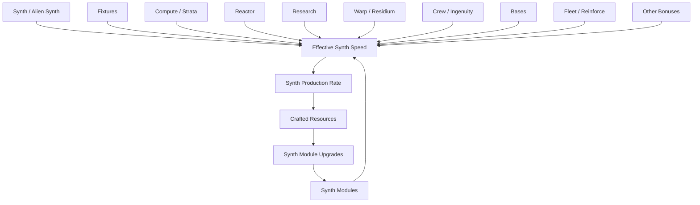

# Synth Speed

**System:** Synth  
**Stat:** Synth Speed  
**Status:** Mapping in progress  
**Reference:** In-game stat breakdown supplied November 25, 2026

## 1. Overview

Synth Speed determines the effective production speed of the Synth system.

The final value is calculated from a base stat, flat additions, and multiplicative bonuses contributed by numerous game systems.

### Reference snapshot

| Component | Value |
|---|---:|
| Base Synth Speed | 1 |
| Flat additions | +1.48 |
| Stat after flat additions | 2.48 |
| Total multiplicative bonus | ×1.04e152 |
| **Final Synth Speed** | **2.57e152** |

Values are taken from an in-game stat breakdown and may be rounded for display.

### Calculation structure

```text
BaseStat = 1

FlatStat = BaseStat + SUM(FlatBonuses)

TotalMultiplier = PRODUCT(AllActiveMultipliers)

FinalSynthSpeed = FlatStat × TotalMultiplier
```

**Verification status:** Formula structure identified from the in-game breakdown. Individual multiplier formulas have not yet been verified.

---

## 2. System Dependency Diagram

The following diagram identifies major contributing systems.



This is a high-level dependency diagram, not a complete calculation model.

---

## 3. Flat Value Additions

| Source | Bonus | Save JSON Key | Formula | Verified |
|---|---:|---|---|---|
| Synth Enhancer Core: S. Speed +0.04 | +1.48 | TBD | TBD | No |

**Total Flat Bonus:** +1.48

---

## 4. Multiplicative Bonuses

These are the actual values displayed by the game in the reference snapshot.

They are observations, not yet verified mathematical formulas.

### Synth, Modules and Compute

| Source | Multiplier | JSON Key | Formula |
|---|---:|---|---|
| Synth Enhancer Core: Synth Speed | ×2 | TBD | TBD |
| Compute Strata: Growth Upgrades | ×17.8 | TBD | TBD |
| Alien Synth: Alien Integration | ×8 | TBD | TBD |
| Alien Synth: Antum Concentrate | ×1.94872 | TBD | TBD |
| Module: Synth Speeder | ×9 | `SynthSpeeder` (candidate) | TBD |
| 9x Synth: Synth Synth Speed | ×30.9 | TBD | TBD |

### Fixtures

| Source | Multiplier | JSON Key | Formula |
|---|---:|---|---|
| Fixture: Synth Speed Fixture | ×590.67 | `FixtureSynthSpeed1` (candidate) | TBD |
| Fixture 2: Synth Speed Fixture | ×3657.26 | TBD | TBD |
| Fixture 3: Synth Speed Fixture | ×95.4 | TBD | TBD |
| Fixture 4: Synth Speed Fixture | ×66.25 | TBD | TBD |

### Shards and Bases

| Source | Multiplier | JSON Key | Formula |
|---|---:|---|---|
| Shard: Manifest Shard X | ×6.65 | TBD | TBD |
| Shard: Flex Shard XI | ×160 | TBD | TBD |
| Base: Base 3 Finalized | ×1.00e9 | TBD | TBD |
| Base: Synth Knowledge | ×5 | TBD | TBD |
| Base: Base 7 Upgrade | ×3.01 | TBD | TBD |

### Ship, Overdrive and Reactor

| Source | Multiplier | JSON Key | Formula |
|---|---:|---|---|
| Ship: Titan Utilities | ×5.40e7 | TBD | TBD |
| 2x Powercell: Synth Speed | ×358.98 | TBD | TBD |
| Overdrive: Synth Active | ×2 | TBD | TBD |
| Overdrive: Synth Passive | ×2.22e19 | TBD | TBD |
| Overdrive: Synth Tier Bonus | ×1.05e6 | TBD | TBD |
| Reactor: Massive Reactor | ×7.25e8 | TBD | TBD |

### Research

| Source | Multiplier | JSON Key | Formula |
|---|---:|---|---|
| 6x Research: Improved Synthing | ×7.12 | TBD | TBD |
| 30x Research: Synth Speed | ×807.79 | TBD | TBD |
| Research: Normal Research Mastered | ×3.95e9 | TBD | TBD |

### Warp and Residium

| Source | Multiplier | JSON Key | Formula |
|---|---:|---|---|
| 2x Warp: Materials Improvement | ×10.13 | TBD | TBD |
| Warp: Synth Improvement MK 1 | ×2.59 | TBD | TBD |
| Warp: Synth Improvement MK 2 | ×3.39 | TBD | TBD |
| Warp: Synth Improvement MK 3 | ×11.47 | TBD | TBD |
| Warp: Synth Improvement MK 4 | ×6.19 | TBD | TBD |
| Warp: Synth Improvement MK 5 | ×131.5 | TBD | TBD |
| Warp: Synth Improvement MK 6 | ×95.4 | TBD | TBD |
| Warp: Synth Improvement MK 7 | ×97.66 | TBD | TBD |
| Warp: Synth Systems | ×1.05 | TBD | TBD |
| 5x Warp: Synth Improvement | ×1.404e4 | TBD | TBD |
| 3x Residuum: Synth Speed | ×151.69 | TBD | TBD |
| 2x Oizys: Synth Speed | ×36 | TBD | TBD |
| 2x Quirinus: Synth Speed | ×36 | TBD | TBD |
| 2x Rumina: Synth Speed | ×81 | TBD | TBD |
| 2x Senectus: Synth Speed | ×6.25 | TBD | TBD |
| Ullr: Synth Speed | ×3 | TBD | TBD |

### Crew, Mastery, Ingenuity and Splicing

| Source | Multiplier | JSON Key | Formula |
|---|---:|---|---|
| Cyber Specialist: Mathematical Materials | ×2229.43 | TBD | TBD |
| Cyber Specialist: Synth Enjoyer | ×1.34e4 | TBD | TBD |
| Materials Engineer: Steady Hand | ×3343.64 | TBD | TBD |
| Materials Engineer: Coordinated Synthing | ×3343.64 | TBD | TBD |
| Materials Engineer: Masterful Synthing | ×4457.86 | TBD | TBD |
| Crew Mastery: Synth Mastery | ×5 | TBD | TBD |
| Crew Mastery 2: Synth Mastery | ×5 | TBD | TBD |
| 15x Ingenuity: Ingenuity Synth Speed | ×15.41 | TBD | TBD |
| 4x Ingenuity: Ingenuity Savant | ×2.86 | TBD | TBD |
| Spliced Materials Engineer: Enhanced Synthing | ×1.88416 | TBD | TBD |
| 2x Splicing: Synth Adaptation | ×3.29 | TBD | TBD |
| 3x Splicing Humanity: Synth Support | ×15.63 | TBD | TBD |

### Achievements, AI, Reinforcement and Fleet

| Source | Multiplier | JSON Key | Formula |
|---|---:|---|---|
| 19x Achievement: Synth Infinite Achievement | ×6.12 | TBD | TBD |
| AI: AI Synth | ×1.1 | TBD | TBD |
| AI Fleet: AI Synth | ×1.1 | TBD | TBD |
| Reinforce: Task List Upgrade | ×4 | TBD | TBD |
| 3x Reinforce: Reinforce Bonus | ×2500 | TBD | TBD |
| 4x Reinforce: Synth Speed | ×2.000e4 | TBD | TBD |
| Reinforce: Titan Building | ×4 | TBD | TBD |
| Reintegration: Reintegration | ×2 | TBD | TBD |
| Fleet: Battle Clear Bonus | ×10.83 | TBD | TBD |
| Fleet Unstable: Unstable Synth Speed | ×1835.28 | TBD | TBD |
| 9x Fleet: Synth Speed | ×8139.55 | TBD | TBD |
| Fleet: Void Energy Replacement | ×2 | TBD | TBD |
| Fleet: Synth Plans | ×10 | TBD | TBD |

**Reported Total Multiplicative Bonus:** ×1.04e152

---

## 5. Save JSON Investigation

The save contains individual progression data that can potentially be mapped to the sources above.

### Known candidate fields

| Component | Candidate JSON key | Saved properties | Mapping status |
|---|---|---|---|
| Synth Speeder module | `SynthSpeeder` | `active`, `level`, `tier`, `locked` | Key identified, formula unknown |
| Synth Speed Fixture 1 | `FixtureSynthSpeed1` | `amount_purchased`, `effect_multiplier`, `progress` | Key identified, formula unknown |
| Compute Strata Synth Speed | `SGSynthSpeed` | `active`, `level`, `progress`, `unlocked` | Key identified, formula unknown |

These field mappings were observed in a previously decoded save. Candidate mappings still need confirmation against the game.

Do not assume `effect_multiplier` represents the final displayed multiplier without verification.

### Important distinction

The JSON contains component progression state and some aggregate statistics.

The detailed source-by-source bonus breakdown may be calculated internally by the game rather than stored directly.

---

## 6. Modifier Rules

The following behaviour must be accounted for when implementing the final calculation.

- Flat bonuses are applied to the base value before multiplication.
- Multiplicative bonuses are combined to produce the final multiplier.
- Only eligible and active bonuses should contribute.
- Synth Modules have a limit of seven simultaneously active modules.
- Purchased upgrades are not necessarily equivalent to active bonuses.
- Formula calculations must retain sufficient precision for scientific notation.
- Display rounding must not affect calculation precision.

**To investigate:** Whether there are additional special-case stacking rules, caps, or conditional bonuses.

---

## 7. Verification Method

Each mapped bonus should be tested against actual game behaviour.

1. Record the relevant saved progression values.
2. Record the in-game displayed multiplier.
3. Identify the candidate formula.
4. Calculate the expected multiplier.
5. Compare it against the game.
6. Repeat at another progression level when possible.
7. Mark the formula verified only when the evidence supports it.

### Verification statuses

| Status | Meaning |
|---|---|
| Unmapped | No JSON source identified |
| Identified | Save field identified |
| Formula Candidate | Formula proposed but not confirmed |
| Verified | Formula successfully compared with game |
| Conditional | Additional activation rules need investigation |

---

## 8. Open Questions

- How is the Synth Enhancer Core's flat addition calculated?
- What is the formula for each Synth Speed Fixture?
- How does the Synth Speeder module's level and tier determine its multiplier?
- Are grouped bonuses such as `9x Synth` calculated from individual upgrades or an aggregate mechanic?
- How are Crew bonuses affected by Humanity, Corruption, Mastery and Splicing?
- Which bonuses are conditional on equipped or active components?
- Can the final Synth Speed value be reproduced from the decoded save alone?

---

## 9. Implementation Notes

**Planned location:** Shared game modifier calculation layer.

**Preferred numerical library:** `decimal.js`

The calculation engine should preserve individual bonus contributions and their source identities before aggregating them.

The output should support both a final effective stat and an explanatory breakdown.

### Future implementation

```text
Save JSON
    ↓
Extract Progression State
    ↓
Calculate Individual Bonuses
    ↓
Resolve Active Conditions
    ↓
Combine Flat Additions
    ↓
Multiply Active Bonuses
    ↓
Effective Synth Speed
    ↓
Synth Calculator
```

No implementation is considered verified until the calculated result matches the corresponding game-state reference.
