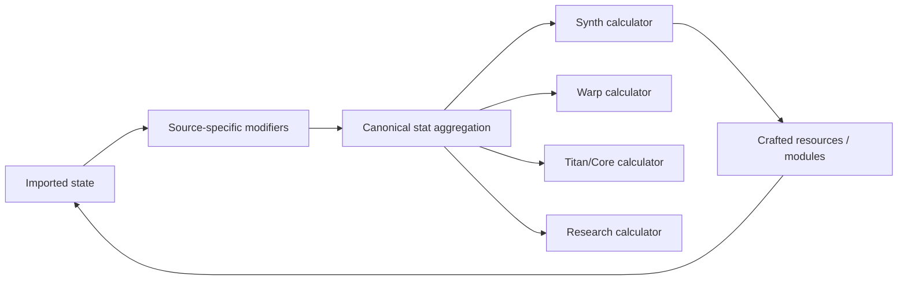

# Modifier Mapping and Validation

**Status:** Framework established; formulas are mostly **unverified**.

This document describes how to map individual game-system upgrades to the effective statistics consumed by the calculators.

## The data model we need

| Field | Meaning |
|---|---|
| `target_stat` | Canonical output, e.g. `synth_speed`, `alien_synth_speed`, `warp_discharge_speed` |
| `source_system` | Where the effect comes from: Warp, Synth, Reactor, Crew, Fleet, etc. |
| `source_name` | Exact in-game tooltip name, preserved verbatim |
| `save_record` | Save `save_name` or related record path, when confirmed |
| `source_level` | Imported level/tier, where relevant |
| `operation` | `flat_add`, `additive_multiplier`, `multiply`, or another **verified** rule |
| `activation` | Equipped, active, unlocked, purchased, milestone, time-limited, etc. |
| `formula` | Function of imported state; do **not** substitute a snapshot's displayed multiplier |
| `observed_value` | The game's rounded contribution in a particular snapshot |
| `verification` | `unmapped`, `identified`, `candidate`, `verified` |

## Illustrative relationships

**This is a dependency sketch, not a simulation flow.** The final feedback arrow denotes progression *in the game*, not permission to mutate the imported baseline.

## Rules established by observed snapshots

- The **Synth Speed** snapshot has base **1**, flat addition **+1.48**, subtotal **2.48**, then displayed multiplicative total approximately **×1.04e152**, final **2.57e152**. See [Synth Speed](bonuses/Synth/synth-speed.md).
- **Alien Synth Speed** is a separate statistic, snapshot **155.25**, with five listed multipliers and the Synth Shard currently unequipped. See [Alien Synth Speed](bonuses/Synth/alien-synth-speed-multiplier.md).
- **Warp Core Charge Speed** displays *three* stages: flat value additions, **additive multipliers**, then multiplicative multipliers. Do not use the simple flat-then-product rule for this statistic without researching the additive phase. See [Warp Core Charge Speed](bonuses/Warp/warp-core-charge-speed.md).
- **Active Module Slots** shows a **negative** flat contribution from Titan Synth/Titan Modules and a positive set of unlock bonuses; allow negative flat effects. See [Active Module Slots](bonuses/Synth/active-module-slots.md).
- A conditional modifier applies only when the source is active/equipped. The player's Synth Shard is **unequipped** in the Alien Synth snapshot; do not add its bonus to the recorded total.
- A displayed factor such as `×590.67` is **not** a progression formula; computing its effect requires the relevant level and scaling rule.

## Precision and regression rules

Keep observed breakdowns and exact save values separately. Format only in the UI. Multiply independent contributions with decimal arithmetic and compare against the **rounding precision of the game's displayed number**. Don't force equality of rounded source factors and the rounded total.

Create test vectors with: game version, save timestamp, target stat, active source IDs/levels, expected displayed stat and expected breakdown. Confirm across two snapshots if possible.

## Known discrepancies / open investigations

| Item | Evidence | Action |
|---|---|---|
| [Synth Base Output](bonuses/Synth/synth-base-output.md) | Listed flat source values are `-1` and `+1`, while the recorded **Total Flat Value Bonus** is `9.96e5` and final stat is `1` | Preserve original; inspect source tooltip/transcription, **do not** carry `9.96e5` into formula |
| [Warp Core Charge Speed](bonuses/Warp/warp-core-charge-speed.md) | Additive multiplier phase includes `+119`, `+4`, `+8`, then multiplicative sources | Reconstruct stage order and exact equation from more examples |
| [Capital Resource Gain](bonuses/Resource/capital-resource-gain.md) | Snapshot lists missing Spliced Technician sources | Leave incompleteness explicit |
| [Fixture Creation Speed](bonuses/Synth/fixture-creation-speed.md) | Missing Module: Fixture Fixer and Spliced Materials Engineer: Fixture Discipline | Do not claim complete coverage |

## External reference pages

- [Synth / Alien Synth / Fixtures](https://spaceidle.game-vault.net/wiki/Synth)
- [Warp Drive](https://spaceidle.game-vault.net/wiki/Warp_Drive)
- [Research](https://spaceidle.game-vault.net/wiki/Research)
- [Compute](https://spaceidle.game-vault.net/wiki/Compute)
- [Reactor](https://spaceidle.game-vault.net/wiki/Reactor)
- [Crew](https://spaceidle.game-vault.net/wiki/Crew)
- [Core](https://spaceidle.game-vault.net/wiki/Core)

**Last reviewed:** 2026-11-26.
