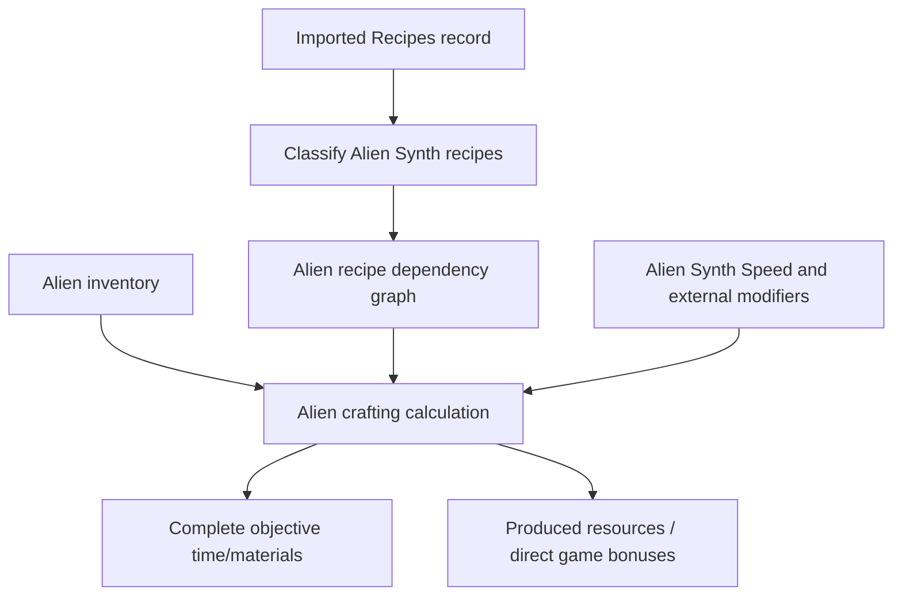

# Alien Synth (Distinct from Standard Synth)

**Status:** Documented scope; recipe extraction, production timing and formulas require validation.

## Confirmed conceptual distinctions

Alien Synth is a later-unlocked subsection of Synth, with its **own recipe chains, inventory and speed value**. It does **not** equip conventional Synth Modules as the regular Synth system does; its production and progression provide bonuses through other mechanics. Do not conflate *Synth Speed* with *Alien Synth Speed Multiplier*.

The game save mixes both systems' recipe records under `save_name: "Recipes"`; this shared storage **does not** mean the two systems use a single inventory or speed multiplier.

User-identified alien recipe chain roots:
```text
VerdanixBaseT1
WraithtexBaseT1
XyltaldarBaseT1
YttaldarBaseT1
ZephyrionBaseT1
```

Each is a `<SpecimenType>BaseT1` form. This is a **starting candidate set**, not a completed classification of the recipe graph: recursively inspect ingredients, recipe relationships, and additional roots before assigning all recipes to a subsystem. Confirm save spelling of keys against the decoded data. **Exact Titan-era unlock stage remains unverified.**

## Reference speed breakdown (November 26, 2026)

| Source | Observed multiplier |
|---|---:|
| Base: Discipline Mastery Renovation | ×8 |
| Ship: Titan Utilities | ×2.3 |
| Splicing Corruption: Alien Synth Speed | ×1.25 |
| 2x Reinforce: Synth Speed | ×2.25 |
| Fleet: Alien Synth | ×3 |
| **Total** | **×155.25** |

Base is 1 and there are no reported flat additions in this captured breakdown. **Synth Shard was unequipped**, so its potential Alien Synth Speed contribution is **not included** in the total. Keep equipped/active state separate from ownership and upgrades.

See [Alien Synth Speed bonus snapshot](../bonuses/Synth/alien-synth-speed-multiplier.md).

## Documentation and calculation design



The graph may **share recursive crafting algorithms** with standard Synth, but its inventory, inputs, speed and reward paths remain independent. Don't assume their exact time formula is identical.

### Questions to verify

- Which game progression unlocks Alien Synth and each tier?
- Do all five roots exhaust the Alien recipe families?
- Where are Alien inventory balances represented in the JSON?
- Does the game's Alien Synth Speed Multiplier affect duration, production rate or both, and in what mathematical manner?
- How are upgrades/recipes and their direct bonuses stored and calculated?
- Which equipment conditions activate shard bonuses?

## Sources

- [Wiki: Synth and Alien Synth](https://spaceidle.game-vault.net/wiki/Synth)
- [Wiki: Splicing](https://spaceidle.game-vault.net/wiki/Splice)
- User-observed JSON and in-game breakdown supplied November 2026.

**Last reviewed:** 2026-11-26.
