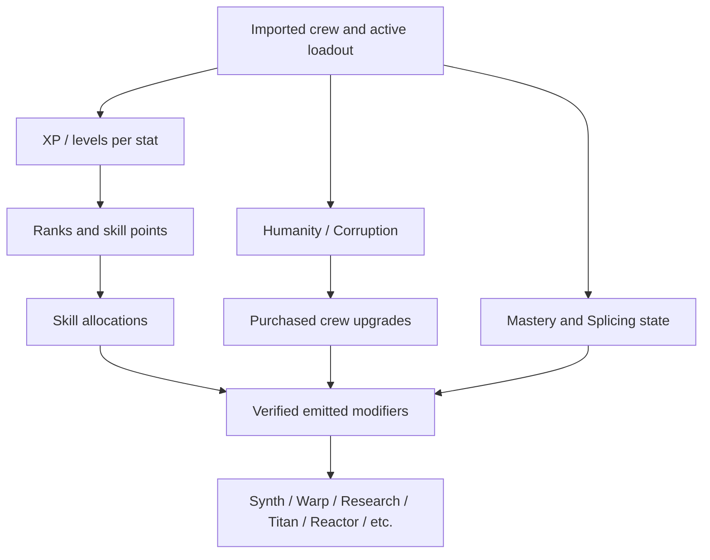

# Crew System

**Status:** Source-grounded outline; the detailed progression and modifier formulas are not yet implemented.

**Primary reference:** [Wiki: Crew](https://spaceidle.game-vault.net/wiki/Crew). Related [Splicing and Crew Extensions](splicing.md).

## Overview

The wiki documents **eight specialists**: Energy Technician, Cyber Specialist, Researcher, Materials Engineer, Logistics Manager, Xeno Phenomenologist, Industrial Engineer and Reconstruction Specialist. Each has **two stats**. Active crew gain XP from battle, and the chosen training stat controls where XP accumulates. Ranks and skill assignments unlock bonuses for other game systems.

Crew is one of the largest future calculator workstreams because progression, assignment, rank delays, mastery, corruption/humanity, splicing and XP reset/catch-up mechanics may all affect its outputs.

## Conceptual relationships

## Observed mechanics from the wiki

- The wiki describes primary- and secondary-stat XP requirements that generally grow at different rates, and XP catch-up benefits after reprinting; these are **wiki observations**, not a verified Titan-phase formula.
- Crew rank thresholds follow milestone sequences affected by rank delay upgrades.
- Crew skill tiers and allocations can include trade-offs or divisors.
- Humanity and Corruption upgrade trees use separate point currencies, with their own ordered row progression. The wiki states a point is earned per 20 aggregate levels of the corresponding type across active Crew, and upgrade cost increases every four levels. Confirm current progression rules against the game version before coding.

## Known cross-system effects

The user's bonus breakdowns already show examples including:
- **Cyber Specialist**: Mathematical Materials, Synth Enjoyer.
- **Materials Engineer**: Steady Hand, Coordinated Synthing, Masterful Synthing.
- **Crew Mastery** and **Crew Mastery 2**: Synth Mastery.
- **Spliced Materials Engineer**: Enhanced Synthing, Research Discipline / other effects depending on specialization.
- **Splicing Humanity**: Synth Support, Titan Array Capacity, and additional stat sources.
- **Splicing Corruption**: Alien Synth Speed, Warp Discharge Support, and others.

These are *observed effect names*. We must identify save keys, activation conditions, and formulas independently.

## Implementation requirements

1. Import each crew member's identity, active status, stat levels, rank, skill distribution and purchased Humanity/Corruption progression.
2. Keep **current crew configuration** separate from historically earned milestones.
3. Compute points available/spent, purchased levels, and permitted skill allocations in pure functions.
4. Calculate currently effective bonuses with source-level provenance.
5. Verify bonuses against in-game stats before connecting to other calculators.

## Open questions

- Exact save records and whether any values are aggregate/cached rather than progression.
- Active crew/biosleeve and reprint mechanics in Titan phase.
- How specialization, splicing, mastery and Humanity/Corruption stack.
- Which persistent crew upgrades survive reinforce/reintegration and which current levels reset.
- Effects of automatic switches and rank upgrades on time estimates.

**Last reviewed:** 2026-11-26.
