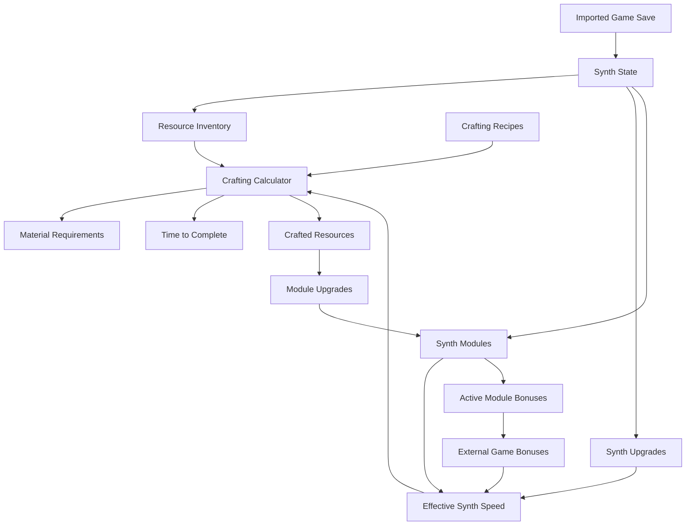
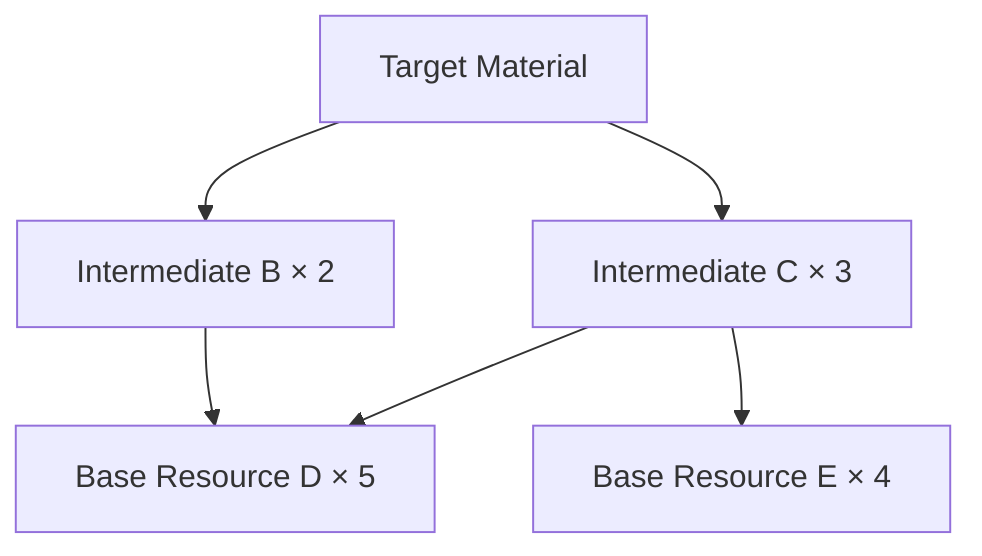

# Synth System

**System:** Synth  
**Implementation status:** Planned  
**Documentation status:** In progress  
**Primary dependencies:** Synth Speed, resource inventory, Synth Modules, external game modifiers

## 1. System Overview

The Synth system produces resources through crafting and synthesis.

These resources are used to purchase upgrades, improve Synth Modules, and support progression in other game systems.

The Synth calculator will estimate the total resources and time needed to achieve a particular crafting objective, including all required intermediate materials.

### Primary objectives

- Track current Synth resources and progression.
- Calculate material requirements for crafting objectives.
- Resolve dependencies between crafted resources.
- Account for available resource inventory.
- Estimate the time required to produce missing resources.
- Apply effective Synth Speed modifiers.
- Track Synth Module levels and activation.
- Calculate bonuses provided by active Synth Modules.

---

## 2. System Architecture



This diagram represents the proposed calculation architecture. The precise game formulas and crafting rules must be verified before implementation.

---

## 3. Major Components

### 3.1 Synth Resources

Synth resources are produced through the Synth system.

Some resources may require other resources as crafting inputs, creating dependency chains.

The calculator must distinguish between:

- Resources currently held.
- Resources required for the objective.
- Resources consumed by intermediate crafting.
- Resources still requiring production.

**Reference data required:**

- Resource identifiers.
- Crafting recipes.
- Ingredient quantities.
- Base crafting times or production rates.
- Unlock conditions, where applicable.

### 3.2 Synth Upgrades

Synth upgrades modify the performance and progression of the Synth system.

Some upgrades provide bonuses to Synth Speed or other game mechanics.

**Save JSON investigation:** Records such as `SynthSynthSpeed` have been identified in previous save analysis.

The exact formula for each upgrade must be documented and verified.

### 3.3 Synth Modules

Synth Modules provide bonuses to multiple systems throughout the game.

**Important constraint: A maximum of seven Synth Modules can be active simultaneously.**

The calculator must distinguish between module progression and module activation.

A module can be owned and upgraded without necessarily contributing an active bonus.

#### Known module bonus categories

| Bonus target | Destination system |
|---|---|
| Titan Damage | Titan |
| Titan Shields | Titan |
| Compute | Compute / Strata |
| Reactor Speed | Reactor |
| Capital Resource Gain | Resources / Bases |
| Synth Speed | Alien Synth |
| Fixture Speed | Fixtures |
| AF Research | Research |
| Specimen Research | Research |
| Crew Adaptions | Crew |
| Mastery Gain | Mastery / Crew |

The exact bonus calculations will be documented under `docs/synth/bonuses/`.

### 3.4 Fixtures

Fixtures are a related subsystem and will have their own documentation:

[Fixtures System](fixtures.md)

Their effects may include Synth Speed and other bonuses.

Fixtures should be calculated independently and contribute their modifiers through the shared mechanics layer.

---

## 4. Crafting Dependencies

The calculator must account for all intermediate crafting requirements.

For example, consider a hypothetical recipe:



**This is an illustrative example, not an actual game recipe.**

Unlike Warp upgrade prerequisites, Synth ingredients may be consumed.

Therefore, two crafting branches requiring the same material may create additional demand rather than sharing a single purchase.

### Dependency calculation requirements

1. Identify the requested target resource and quantity.
2. Resolve the complete crafting dependency chain.
3. Aggregate ingredient requirements across all branches.
4. Subtract available inventory at the appropriate points.
5. Determine the remaining crafting quantities.
6. Calculate total time using effective production rates.

Additional investigation is required to establish whether crafting processes can run concurrently and how resource consumption is scheduled.

---

## 5. Synth Speed

Synth Speed is influenced by numerous systems.

The reference snapshot supplied from the game displays:

| Component | Value |
|---|---:|
| Base | 1 |
| Flat additions | +1.48 |
| Stat after flat additions | 2.48 |
| Multiplicative bonuses | ×1.04e152 |
| Final displayed speed | 2.57e152 |

### General calculation structure

```text
EffectiveSynthSpeed =
    (BaseSynthSpeed + FlatBonuses)
    × Product(ActiveMultipliers)
```

The exact contribution of each modifier must be calculated using its relevant upgrade progression and activation conditions.

See [Synth Speed Bonus Reference](../bonuses/synth/synth-speed.md) for the complete known multiplier list and verification work.

---

## 6. External Dependencies

The Synth system receives bonuses from numerous other game systems.

| Source system | Known or potential contribution |
|---|---|
| Compute / Strata | Growth and Synth Speed multipliers |
| Reactor | Synth Speed |
| Warp / Residium | Synth improvements and speed |
| Crew | Synth-related bonuses and mastery |
| Fixtures | Synth Speed |
| Research | Improved Synthing and Synth Speed |
| Bases | Synth bonuses |
| Titan | Synth Speed through Titan Utilities |
| Fleet | Synth-related bonuses |
| Reinforcement | Synth Speed and progression bonuses |
| Shards | Synth Speed multipliers |

These relationships are based on the supplied Synth Speed breakdown.

Individual contributions must be verified before being implemented.

---

## 7. System Outputs

The Synth system provides several important outputs to the rest of the calculator.

| Output | Purpose |
|---|---|
| Synth resource inventory | Available materials |
| Resource production estimates | Crafting time calculations |
| Synth Module progression | Determine module bonus strength |
| Active Synth Module bonuses | Modify other game systems |
| Effective Synth Speed | Calculate Synth production |

The seven-module activation limit must be respected when calculating active modifiers.

---

## 8. Save JSON Mapping

The game save is the authoritative imported baseline.

Initial candidate mappings identified during previous save analysis:

| Game component | Save field | Data |
|---|---|---|
| Synth Speeder module | `SynthSpeeder` | Level, tier, active state, locked state |
| Synth Speed upgrade | `SynthSynthSpeed` | Purchased progression |
| Synth Speed Strata | `SGSynthSpeed` | Level, progress, active state |
| Synth Speed fixture | `FixtureSynthSpeed1` | Purchased progression and fixture state |

These mappings require further validation and do not constitute a complete Synth save schema.

### Import requirements

The import process should eventually extract:

- Synth resource balances.
- Synth upgrade progression.
- Synth Module levels and tiers.
- Active module selection.
- Relevant unlock states.
- Any crafting or production progress present in the save.

Only confirmed save fields should be used for persisted game-state calculations.

---

## 9. Calculator Functionality

### Basic calculator

**Status: Not yet implemented**

The first version should support:

- Resource and inventory display.
- Selection of a target resource and quantity.
- Full recursive ingredient requirements.
- Existing-inventory deductions.
- Effective crafting time estimates.
- Explanatory breakdowns of the results.

### Module management

**Status: Not yet implemented**

The module interface should support:

- Viewing module levels.
- Viewing module bonuses.
- Identifying active modules.
- Enforcing the seven-active-module limit.
- Calculating bonuses from the active module set.

### Future functionality

Goal simulation may eventually evaluate whether crafting resources, upgrading modules, or changing module activation improves progression toward a selected objective.

This is explicitly outside the initial calculator scope.

---

## 10. Validation Strategy

Calculations should be compared with the actual game.

### Resource validation

- Verify recipe ingredient quantities.
- Verify current inventory values.
- Verify dependency-chain requirements.
- Verify crafting time for an individual resource.
- Verify total crafting time for a multi-stage objective.

### Module validation

- Verify imported module levels and tiers.
- Verify active module states.
- Verify calculated bonus values.
- Verify the seven-active-module limit.

### Modifier validation

- Compare calculated Synth Speed against the in-game stat breakdown.
- Identify the source of any difference.
- Verify individual# Alien Synth System

**System:** Alien Synth  
**Implementation status:** Planned  
**Documentation status:** In progress  
**Primary dependencies:** Synth Speed, resource inventory, Synth Modules, external game modifiers

## 1. System Overview

The Alien Synth system produces resources through crafting and synthesis.

These resources are used to purchase upgrades, improve Synth Modules, and support progression in other game systems.

The Synth calculator will estimate the total resources and time needed to achieve a particular crafting objective, including all required intermediate materials.

### Primary objectives

- Track current Synth resources and progression.
- Calculate material requirements for crafting objectives.
- Resolve dependencies between crafted resources.
- Account for available resource inventory.
- Estimate the time required to produce missing resources.
- Apply effective Synth Speed modifiers.
- Track Synth Module levels and activation.
- Calculate bonuses provided by active Synth Modules.

---

## 2. System Architecture


This diagram represents the proposed calculation architecture. The precise game formulas and crafting rules must be verified before implementation.

---

## 3. Major Components

### 3.1 Synth Resources

Synth resources are produced through the Alien Synth system.

Some resources may require other resources as crafting inputs, creating dependency chains.

The calculator must distinguish between:

- Resources currently held.
- Resources required for the objective.
- Resources consumed by intermediate crafting.
- Resources still requiring production.

**Reference data required:**

- Resource identifiers.
- Crafting recipes.
- Ingredient quantities.
- Base crafting times or production rates.
- Unlock conditions, where applicable.

### 3.2 Synth Upgrades

Synth upgrades modify the performance and progression of the Synth system.

Some upgrades provide bonuses to Synth Speed or other game mechanics.

**Save JSON investigation:** Records such as `SynthSynthSpeed` have been identified in previous save analysis.

The exact formula for each upgrade must be documented and verified.

### 3.3 Synth Modules

Synth Modules provide bonuses to multiple systems throughout the game.

**Important constraint: A maximum of seven Synth Modules can be active simultaneously.**

The calculator must distinguish between module progression and module activation.

A module can be owned and upgraded without necessarily contributing an active bonus.

#### Known module bonus categories

| Bonus target | Destination system |
|---|---|
| Titan Damage | Titan |
| Titan Shields | Titan |
| Compute | Compute / Strata |
| Reactor Speed | Reactor |
| Capital Resource Gain | Resources / Bases |
| Synth Speed | Alien Synth |
| Fixture Speed | Fixtures |
| AF Research | Research |
| Specimen Research | Research |
| Crew Adaptions | Crew |
| Mastery Gain | Mastery / Crew |

The exact bonus calculations will be documented under `docs/bonuses/`.

### 3.4 Fixtures

Fixtures are a related subsystem and will have their own documentation:

[Fixtures System](fixtures.md)

Their effects may include Synth Speed and other bonuses.

Fixtures should be calculated independently and contribute their modifiers through the shared mechanics layer.

---

## 4. Crafting Dependencies

The calculator must account for all intermediate crafting requirements.

For example, consider a hypothetical recipe:


**This is an illustrative example, not an actual game recipe.**

Unlike Warp upgrade prerequisites, Synth ingredients may be consumed.

Therefore, two crafting branches requiring the same material may create additional demand rather than sharing a single purchase.

### Dependency calculation requirements

1. Identify the requested target resource and quantity.
2. Resolve the complete crafting dependency chain.
3. Aggregate ingredient requirements across all branches.
4. Subtract available inventory at the appropriate points.
5. Determine the remaining crafting quantities.
6. Calculate total time using effective production rates.

Additional investigation is required to establish whether crafting processes can run concurrently and how resource consumption is scheduled.

---

## 5. Synth Speed

Synth Speed is influenced by numerous systems.

The reference snapshot supplied from the game displays:

| Component | Value |
|---|---:|
| Base | 1 |
| Flat additions | +1.48 |
| Stat after flat additions | 2.48 |
| Multiplicative bonuses | ×1.04e152 |
| Final displayed speed | 2.57e152 |

### General calculation structure

```text
EffectiveSynthSpeed =
    (BaseSynthSpeed + FlatBonuses)
    × Product(ActiveMultipliers)
```

The exact contribution of each modifier must be calculated using its relevant upgrade progression and activation conditions.

See [Synth Speed Bonus Reference](../bonuses/synth-speed.md) for the complete known multiplier list and verification work.

---

## 6. External Dependencies

The Synth system receives bonuses from numerous other game systems.

| Source system | Known or potential contribution |
|---|---|
| Compute / Strata | Growth and Synth Speed multipliers |
| Reactor | Synth Speed |
| Warp / Residium | Synth improvements and speed |
| Crew | Synth-related bonuses and mastery |
| Fixtures | Synth Speed |
| Research | Improved Synthing and Synth Speed |
| Bases | Synth bonuses |
| Titan | Synth Speed through Titan Utilities |
| Fleet | Synth-related bonuses |
| Reinforcement | Synth Speed and progression bonuses |
| Shards | Synth Speed multipliers |

These relationships are based on the supplied Synth Speed breakdown.

Individual contributions must be verified before being implemented.

---

## 7. System Outputs

The Synth system provides several important outputs to the rest of the calculator.

| Output | Purpose |
|---|---|
| Synth resource inventory | Available materials |
| Resource production estimates | Crafting time calculations |
| Synth Module progression | Determine module bonus strength |
| Active Synth Module bonuses | Modify other game systems |
| Effective Synth Speed | Calculate Synth production |

The seven-module activation limit must be respected when calculating active modifiers.

---

## 8. Save JSON Mapping

The game save is the authoritative imported baseline.

Initial candidate mappings identified during previous save analysis:

| Game component | Save field | Data |
|---|---|---|
| Synth Speeder module | `SynthSpeeder` | Level, tier, active state, locked state |
| Synth Speed upgrade | `SynthSynthSpeed` | Purchased progression |
| Synth Speed Strata | `SGSynthSpeed` | Level, progress, active state |
| Synth Speed fixture | `FixtureSynthSpeed1` | Purchased progression and fixture state |

These mappings require further validation and do not constitute a complete Synth save schema.

### Import requirements

The import process should eventually extract:

- Synth resource balances.
- Synth upgrade progression.
- Synth Module levels and tiers.
- Active module selection.
- Relevant unlock states.
- Any crafting or production progress present in the save.

Only confirmed save fields should be used for persisted game-state calculations.

---

## 9. Calculator Functionality

### Basic calculator

**Status: Not yet implemented**

The first version should support:

- Resource and inventory display.
- Selection of a target resource and quantity.
- Full recursive ingredient requirements.
- Existing-inventory deductions.
- Effective crafting time estimates.
- Explanatory breakdowns of the results.

### Module management

**Status: Not yet implemented**

The module interface should support:

- Viewing module levels.
- Viewing module bonuses.
- Identifying active modules.
- Enforcing the seven-active-module limit.
- Calculating bonuses from the active module set.

### Future functionality

Goal simulation may eventually evaluate whether crafting resources, upgrading modules, or changing module activation improves progression toward a selected objective.

This is explicitly outside the initial calculator scope.

---

## 10. Validation Strategy

Calculations should be compared with the actual game.

### Resource validation

- Verify recipe ingredient quantities.
- Verify current inventory values.
- Verify dependency-chain requirements.
- Verify crafting time for an individual resource.
- Verify total crafting time for a multi-stage objective.

### Module validation

- Verify imported module levels and tiers.
- Verify active module states.
- Verify calculated bonus values.
- Verify the seven-active-module limit.

### Modifier validation

- Compare calculated Synth Speed against the in-game stat breakdown.
- Identify the source of any difference.
- Verify individual# Alien Synth System

**System:** Alien Synth  
**Implementation status:** Planned  
**Documentation status:** In progress  
**Primary dependencies:** Synth Speed, resource inventory, Synth Modules, external game modifiers

## 1. System Overview

The Alien Synth system produces resources through crafting and synthesis.

These resources are used to purchase upgrades, improve Synth Modules, and support progression in other game systems.

The Synth calculator will estimate the total resources and time needed to achieve a particular crafting objective, including all required intermediate materials.

### Primary objectives

- Track current Synth resources and progression.
- Calculate material requirements for crafting objectives.
- Resolve dependencies between crafted resources.
- Account for available resource inventory.
- Estimate the time required to produce missing resources.
- Apply effective Synth Speed modifiers.
- Track Synth Module levels and activation.
- Calculate bonuses provided by active Synth Modules.

---

## 2. System Architecture


This diagram represents the proposed calculation architecture. The precise game formulas and crafting rules must be verified before implementation.

---

## 3. Major Components

### 3.1 Synth Resources

Synth resources are produced through the Alien Synth system.

Some resources may require other resources as crafting inputs, creating dependency chains.

The calculator must distinguish between:

- Resources currently held.
- Resources required for the objective.
- Resources consumed by intermediate crafting.
- Resources still requiring production.

**Reference data required:**

- Resource identifiers.
- Crafting recipes.
- Ingredient quantities.
- Base crafting times or production rates.
- Unlock conditions, where applicable.

### 3.2 Synth Upgrades

Synth upgrades modify the performance and progression of the Synth system.

Some upgrades provide bonuses to Synth Speed or other game mechanics.

**Save JSON investigation:** Records such as `SynthSynthSpeed` have been identified in previous save analysis.

The exact formula for each upgrade must be documented and verified.

### 3.3 Synth Modules

Synth Modules provide bonuses to multiple systems throughout the game.

**Important constraint: A maximum of seven Synth Modules can be active simultaneously.**

The calculator must distinguish between module progression and module activation.

A module can be owned and upgraded without necessarily contributing an active bonus.

#### Known module bonus categories

| Bonus target | Destination system |
|---|---|
| Titan Damage | Titan |
| Titan Shields | Titan |
| Compute | Compute / Strata |
| Reactor Speed | Reactor |
| Capital Resource Gain | Resources / Bases |
| Synth Speed | Alien Synth |
| Fixture Speed | Fixtures |
| AF Research | Research |
| Specimen Research | Research |
| Crew Adaptions | Crew |
| Mastery Gain | Mastery / Crew |

The exact bonus calculations will be documented under `docs/bonuses/`.

### 3.4 Fixtures

Fixtures are a related subsystem and will have their own documentation:

[Fixtures System](fixtures.md)

Their effects may include Synth Speed and other bonuses.

Fixtures should be calculated independently and contribute their modifiers through the shared mechanics layer.

---

## 4. Crafting Dependencies

The calculator must account for all intermediate crafting requirements.

For example, consider a hypothetical recipe:


**This is an illustrative example, not an actual game recipe.**

Unlike Warp upgrade prerequisites, Synth ingredients may be consumed.

Therefore, two crafting branches requiring the same material may create additional demand rather than sharing a single purchase.

### Dependency calculation requirements

1. Identify the requested target resource and quantity.
2. Resolve the complete crafting dependency chain.
3. Aggregate ingredient requirements across all branches.
4. Subtract available inventory at the appropriate points.
5. Determine the remaining crafting quantities.
6. Calculate total time using effective production rates.

Additional investigation is required to establish whether crafting processes can run concurrently and how resource consumption is scheduled.

---

## 5. Synth Speed

Synth Speed is influenced by numerous systems.

The reference snapshot supplied from the game displays:

| Component | Value |
|---|---:|
| Base | 1 |
| Flat additions | +1.48 |
| Stat after flat additions | 2.48 |
| Multiplicative bonuses | ×1.04e152 |
| Final displayed speed | 2.57e152 |

### General calculation structure

```text
EffectiveSynthSpeed =
    (BaseSynthSpeed + FlatBonuses)
    × Product(ActiveMultipliers)
```

The exact contribution of each modifier must be calculated using its relevant upgrade progression and activation conditions.

See [Synth Speed Bonus Reference](../bonuses/synth-speed.md) for the complete known multiplier list and verification work.

---

## 6. External Dependencies

The Synth system receives bonuses from numerous other game systems.

| Source system | Known or potential contribution |
|---|---|
| Compute / Strata | Growth and Synth Speed multipliers |
| Reactor | Synth Speed |
| Warp / Residium | Synth improvements and speed |
| Crew | Synth-related bonuses and mastery |
| Fixtures | Synth Speed |
| Research | Improved Synthing and Synth Speed |
| Bases | Synth bonuses |
| Titan | Synth Speed through Titan Utilities |
| Fleet | Synth-related bonuses |
| Reinforcement | Synth Speed and progression bonuses |
| Shards | Synth Speed multipliers |

These relationships are based on the supplied Synth Speed breakdown.

Individual contributions must be verified before being implemented.

---

## 7. System Outputs

The Synth system provides several important outputs to the rest of the calculator.

| Output | Purpose |
|---|---|
| Synth resource inventory | Available materials |
| Resource production estimates | Crafting time calculations |
| Synth Module progression | Determine module bonus strength |
| Active Synth Module bonuses | Modify other game systems |
| Effective Synth Speed | Calculate Synth production |

The seven-module activation limit must be respected when calculating active modifiers.

---

## 8. Save JSON Mapping

The game save is the authoritative imported baseline.

Initial candidate mappings identified during previous save analysis:

| Game component | Save field | Data |
|---|---|---|
| Synth Speeder module | `SynthSpeeder` | Level, tier, active state, locked state |
| Synth Speed upgrade | `SynthSynthSpeed` | Purchased progression |
| Synth Speed Strata | `SGSynthSpeed` | Level, progress, active state |
| Synth Speed fixture | `FixtureSynthSpeed1` | Purchased progression and fixture state |

These mappings require further validation and do not constitute a complete Synth save schema.

### Import requirements

The import process should eventually extract:

- Synth resource balances.
- Synth upgrade progression.
- Synth Module levels and tiers.
- Active module selection.
- Relevant unlock states.
- Any crafting or production progress present in the save.

Only confirmed save fields should be used for persisted game-state calculations.

---

## 9. Calculator Functionality

### Basic calculator

**Status: Not yet implemented**

The first version should support:

- Resource and inventory display.
- Selection of a target resource and quantity.
- Full recursive ingredient requirements.
- Existing-inventory deductions.
- Effective crafting time estimates.
- Explanatory breakdowns of the results.

### Module management

**Status: Not yet implemented**

The module interface should support:

- Viewing module levels.
- Viewing module bonuses.
- Identifying active modules.
- Enforcing the seven-active-module limit.
- Calculating bonuses from the active module set.

### Future functionality

Goal simulation may eventually evaluate whether crafting resources, upgrading modules, or changing module activation improves progression toward a selected objective.

This is explicitly outside the initial calculator scope.

---

## 10. Validation Strategy

Calculations should be compared with the actual game.

### Resource validation

- Verify recipe ingredient quantities.
- Verify current inventory values.
- Verify dependency-chain requirements.
- Verify crafting time for an individual resource.
- Verify total crafting time for a multi-stage objective.

### Module validation

- Verify imported module levels and tiers.
- Verify active module states.
- Verify calculated bonus values.
- Verify the seven-active-module limit.

### Modifier validation

- Compare calculated Synth Speed against the in-game stat breakdown.
- Identify the source of any difference.
- Verify individual# Alien Synth System

**System:** Alien Synth  
**Implementation status:** Planned  
**Documentation status:** In progress  
**Primary dependencies:** Synth Speed, resource inventory, Synth Modules, external game modifiers

## 1. System Overview

The Alien Synth system produces resources through crafting and synthesis.

These resources are used to purchase upgrades, improve Synth Modules, and support progression in other game systems.

The Synth calculator will estimate the total resources and time needed to achieve a particular crafting objective, including all required intermediate materials.

### Primary objectives

- Track current Synth resources and progression.
- Calculate material requirements for crafting objectives.
- Resolve dependencies between crafted resources.
- Account for available resource inventory.
- Estimate the time required to produce missing resources.
- Apply effective Synth Speed modifiers.
- Track Synth Module levels and activation.
- Calculate bonuses provided by active Synth Modules.

---

## 2. System Architecture


This diagram represents the proposed calculation architecture. The precise game formulas and crafting rules must be verified before implementation.

---

## 3. Major Components

### 3.1 Synth Resources

Synth resources are produced through the Alien Synth system.

Some resources may require other resources as crafting inputs, creating dependency chains.

The calculator must distinguish between:

- Resources currently held.
- Resources required for the objective.
- Resources consumed by intermediate crafting.
- Resources still requiring production.

**Reference data required:**

- Resource identifiers.
- Crafting recipes.
- Ingredient quantities.
- Base crafting times or production rates.
- Unlock conditions, where applicable.

### 3.2 Synth Upgrades

Synth upgrades modify the performance and progression of the Synth system.

Some upgrades provide bonuses to Synth Speed or other game mechanics.

**Save JSON investigation:** Records such as `SynthSynthSpeed` have been identified in previous save analysis.

The exact formula for each upgrade must be documented and verified.

### 3.3 Synth Modules

Synth Modules provide bonuses to multiple systems throughout the game.

**Important constraint: A maximum of seven Synth Modules can be active simultaneously.**

The calculator must distinguish between module progression and module activation.

A module can be owned and upgraded without necessarily contributing an active bonus.

#### Known module bonus categories

| Bonus target | Destination system |
|---|---|
| Titan Damage | Titan |
| Titan Shields | Titan |
| Compute | Compute / Strata |
| Reactor Speed | Reactor |
| Capital Resource Gain | Resources / Bases |
| Synth Speed | Alien Synth |
| Fixture Speed | Fixtures |
| AF Research | Research |
| Specimen Research | Research |
| Crew Adaptions | Crew |
| Mastery Gain | Mastery / Crew |

The exact bonus calculations will be documented under `docs/bonuses/`.

### 3.4 Fixtures

Fixtures are a related subsystem and will have their own documentation:

[Fixtures System](fixtures.md)

Their effects may include Synth Speed and other bonuses.

Fixtures should be calculated independently and contribute their modifiers through the shared mechanics layer.

---

## 4. Crafting Dependencies

The calculator must account for all intermediate crafting requirements.

For example, consider a hypothetical recipe:


**This is an illustrative example, not an actual game recipe.**

Unlike Warp upgrade prerequisites, Synth ingredients may be consumed.

Therefore, two crafting branches requiring the same material may create additional demand rather than sharing a single purchase.

### Dependency calculation requirements

1. Identify the requested target resource and quantity.
2. Resolve the complete crafting dependency chain.
3. Aggregate ingredient requirements across all branches.
4. Subtract available inventory at the appropriate points.
5. Determine the remaining crafting quantities.
6. Calculate total time using effective production rates.

Additional investigation is required to establish whether crafting processes can run concurrently and how resource consumption is scheduled.

---

## 5. Synth Speed

Synth Speed is influenced by numerous systems.

The reference snapshot supplied from the game displays:

| Component | Value |
|---|---:|
| Base | 1 |
| Flat additions | +1.48 |
| Stat after flat additions | 2.48 |
| Multiplicative bonuses | ×1.04e152 |
| Final displayed speed | 2.57e152 |

### General calculation structure

```text
EffectiveSynthSpeed =
    (BaseSynthSpeed + FlatBonuses)
    × Product(ActiveMultipliers)
```

The exact contribution of each modifier must be calculated using its relevant upgrade progression and activation conditions.

See [Synth Speed Bonus Reference](../bonuses/synth-speed.md) for the complete known multiplier list and verification work.

---

## 6. External Dependencies

The Synth system receives bonuses from numerous other game systems.

| Source system | Known or potential contribution |
|---|---|
| Compute / Strata | Growth and Synth Speed multipliers |
| Reactor | Synth Speed |
| Warp / Residium | Synth improvements and speed |
| Crew | Synth-related bonuses and mastery |
| Fixtures | Synth Speed |
| Research | Improved Synthing and Synth Speed |
| Bases | Synth bonuses |
| Titan | Synth Speed through Titan Utilities |
| Fleet | Synth-related bonuses |
| Reinforcement | Synth Speed and progression bonuses |
| Shards | Synth Speed multipliers |

These relationships are based on the supplied Synth Speed breakdown.

Individual contributions must be verified before being implemented.

---

## 7. System Outputs

The Synth system provides several important outputs to the rest of the calculator.

| Output | Purpose |
|---|---|
| Synth resource inventory | Available materials |
| Resource production estimates | Crafting time calculations |
| Synth Module progression | Determine module bonus strength |
| Active Synth Module bonuses | Modify other game systems |
| Effective Synth Speed | Calculate Synth production |

The seven-module activation limit must be respected when calculating active modifiers.

---

## 8. Save JSON Mapping

The game save is the authoritative imported baseline.

Initial candidate mappings identified during previous save analysis:

| Game component | Save field | Data |
|---|---|---|
| Synth Speeder module | `SynthSpeeder` | Level, tier, active state, locked state |
| Synth Speed upgrade | `SynthSynthSpeed` | Purchased progression |
| Synth Speed Strata | `SGSynthSpeed` | Level, progress, active state |
| Synth Speed fixture | `FixtureSynthSpeed1` | Purchased progression and fixture state |

These mappings require further validation and do not constitute a complete Synth save schema.

### Import requirements

The import process should eventually extract:

- Synth resource balances.
- Synth upgrade progression.
- Synth Module levels and tiers.
- Active module selection.
- Relevant unlock states.
- Any crafting or production progress present in the save.

Only confirmed save fields should be used for persisted game-state calculations.

---

## 9. Calculator Functionality

### Basic calculator

**Status: Not yet implemented**

The first version should support:

- Resource and inventory display.
- Selection of a target resource and quantity.
- Full recursive ingredient requirements.
- Existing-inventory deductions.
- Effective crafting time estimates.
- Explanatory breakdowns of the results.

### Module management

**Status: Not yet implemented**

The module interface should support:

- Viewing module levels.
- Viewing module bonuses.
- Identifying active modules.
- Enforcing the seven-active-module limit.
- Calculating bonuses from the active module set.

### Future functionality

Goal simulation may eventually evaluate whether crafting resources, upgrading modules, or changing module activation improves progression toward a selected objective.

This is explicitly outside the initial calculator scope.

---

## 10. Validation Strategy

Calculations should be compared with the actual game.

### Resource validation

- Verify recipe ingredient quantities.
- Verify current inventory values.
- Verify dependency-chain requirements.
- Verify crafting time for an individual resource.
- Verify total crafting time for a multi-stage objective.

### Module validation

- Verify imported module levels and tiers.
- Verify active module states.
- Verify calculated bonus values.
- Verify the seven-active-module limit.

### Modifier validation

- Compare calculated Synth Speed against the in-game stat breakdown.
- Identify the source of any difference.
- Verify individual# Alien Synth System

**System:** Alien Synth  
**Implementation status:** Planned  
**Documentation status:** In progress  
**Primary dependencies:** Synth Speed, resource inventory, Synth Modules, external game modifiers

## 1. System Overview

The Alien Synth system produces resources through crafting and synthesis.

These resources are used to purchase upgrades, improve Synth Modules, and support progression in other game systems.

The Synth calculator will estimate the total resources and time needed to achieve a particular crafting objective, including all required intermediate materials.

### Primary objectives

- Track current Synth resources and progression.
- Calculate material requirements for crafting objectives.
- Resolve dependencies between crafted resources.
- Account for available resource inventory.
- Estimate the time required to produce missing resources.
- Apply effective Synth Speed modifiers.
- Track Synth Module levels and activation.
- Calculate bonuses provided by active Synth Modules.

---

## 2. System Architecture


This diagram represents the proposed calculation architecture. The precise game formulas and crafting rules must be verified before implementation.

---

## 3. Major Components

### 3.1 Synth Resources

Synth resources are produced through the Alien Synth system.

Some resources may require other resources as crafting inputs, creating dependency chains.

The calculator must distinguish between:

- Resources currently held.
- Resources required for the objective.
- Resources consumed by intermediate crafting.
- Resources still requiring production.

**Reference data required:**

- Resource identifiers.
- Crafting recipes.
- Ingredient quantities.
- Base crafting times or production rates.
- Unlock conditions, where applicable.

### 3.2 Synth Upgrades

Synth upgrades modify the performance and progression of the Synth system.

Some upgrades provide bonuses to Synth Speed or other game mechanics.

**Save JSON investigation:** Records such as `SynthSynthSpeed` have been identified in previous save analysis.

The exact formula for each upgrade must be documented and verified.

### 3.3 Synth Modules

Synth Modules provide bonuses to multiple systems throughout the game.

**Important constraint: A maximum of seven Synth Modules can be active simultaneously.**

The calculator must distinguish between module progression and module activation.

A module can be owned and upgraded without necessarily contributing an active bonus.

#### Known module bonus categories

| Bonus target | Destination system |
|---|---|
| Titan Damage | Titan |
| Titan Shields | Titan |
| Compute | Compute / Strata |
| Reactor Speed | Reactor |
| Capital Resource Gain | Resources / Bases |
| Synth Speed | Alien Synth |
| Fixture Speed | Fixtures |
| AF Research | Research |
| Specimen Research | Research |
| Crew Adaptions | Crew |
| Mastery Gain | Mastery / Crew |

The exact bonus calculations will be documented under `docs/bonuses/`.

### 3.4 Fixtures

Fixtures are a related subsystem and will have their own documentation:

[Fixtures System](fixtures.md)

Their effects may include Synth Speed and other bonuses.

Fixtures should be calculated independently and contribute their modifiers through the shared mechanics layer.

---

## 4. Crafting Dependencies

The calculator must account for all intermediate crafting requirements.

For example, consider a hypothetical recipe:


**This is an illustrative example, not an actual game recipe.**

Unlike Warp upgrade prerequisites, Synth ingredients may be consumed.

Therefore, two crafting branches requiring the same material may create additional demand rather than sharing a single purchase.

### Dependency calculation requirements

1. Identify the requested target resource and quantity.
2. Resolve the complete crafting dependency chain.
3. Aggregate ingredient requirements across all branches.
4. Subtract available inventory at the appropriate points.
5. Determine the remaining crafting quantities.
6. Calculate total time using effective production rates.

Additional investigation is required to establish whether crafting processes can run concurrently and how resource consumption is scheduled.

---

## 5. Synth Speed

Synth Speed is influenced by numerous systems.

The reference snapshot supplied from the game displays:

| Component | Value |
|---|---:|
| Base | 1 |
| Flat additions | +1.48 |
| Stat after flat additions | 2.48 |
| Multiplicative bonuses | ×1.04e152 |
| Final displayed speed | 2.57e152 |

### General calculation structure

```text
EffectiveSynthSpeed =
    (BaseSynthSpeed + FlatBonuses)
    × Product(ActiveMultipliers)
```

The exact contribution of each modifier must be calculated using its relevant upgrade progression and activation conditions.

See [Synth Speed Bonus Reference](../bonuses/synth-speed.md) for the complete known multiplier list and verification work.

---

## 6. External Dependencies

The Synth system receives bonuses from numerous other game systems.

| Source system | Known or potential contribution |
|---|---|
| Compute / Strata | Growth and Synth Speed multipliers |
| Reactor | Synth Speed |
| Warp / Residium | Synth improvements and speed |
| Crew | Synth-related bonuses and mastery |
| Fixtures | Synth Speed |
| Research | Improved Synthing and Synth Speed |
| Bases | Synth bonuses |
| Titan | Synth Speed through Titan Utilities |
| Fleet | Synth-related bonuses |
| Reinforcement | Synth Speed and progression bonuses |
| Shards | Synth Speed multipliers |

These relationships are based on the supplied Synth Speed breakdown.

Individual contributions must be verified before being implemented.

---

## 7. System Outputs

The Synth system provides several important outputs to the rest of the calculator.

| Output | Purpose |
|---|---|
| Synth resource inventory | Available materials |
| Resource production estimates | Crafting time calculations |
| Synth Module progression | Determine module bonus strength |
| Active Synth Module bonuses | Modify other game systems |
| Effective Synth Speed | Calculate Synth production |

The seven-module activation limit must be respected when calculating active modifiers.

---

## 8. Save JSON Mapping

The game save is the authoritative imported baseline.

Initial candidate mappings identified during previous save analysis:

| Game component | Save field | Data |
|---|---|---|
| Synth Speeder module | `SynthSpeeder` | Level, tier, active state, locked state |
| Synth Speed upgrade | `SynthSynthSpeed` | Purchased progression |
| Synth Speed Strata | `SGSynthSpeed` | Level, progress, active state |
| Synth Speed fixture | `FixtureSynthSpeed1` | Purchased progression and fixture state |

These mappings require further validation and do not constitute a complete Synth save schema.

### Import requirements

The import process should eventually extract:

- Synth resource balances.
- Synth upgrade progression.
- Synth Module levels and tiers.
- Active module selection.
- Relevant unlock states.
- Any crafting or production progress present in the save.

Only confirmed save fields should be used for persisted game-state calculations.

---

## 9. Calculator Functionality

### Basic calculator

**Status: Not yet implemented**

The first version should support:

- Resource and inventory display.
- Selection of a target resource and quantity.
- Full recursive ingredient requirements.
- Existing-inventory deductions.
- Effective crafting time estimates.
- Explanatory breakdowns of the results.

### Module management

**Status: Not yet implemented**

The module interface should support:

- Viewing module levels.
- Viewing module bonuses.
- Identifying active modules.
- Enforcing the seven-active-module limit.
- Calculating bonuses from the active module set.

### Future functionality

Goal simulation may eventually evaluate whether crafting resources, upgrading modules, or changing module activation improves progression toward a selected objective.

This is explicitly outside the initial calculator scope.

---

## 10. Validation Strategy

Calculations should be compared with the actual game.

### Resource validation

- Verify recipe ingredient quantities.
- Verify current inventory values.
- Verify dependency-chain requirements.
- Verify crafting time for an individual resource.
- Verify total crafting time for a multi-stage objective.

### Module validation

- Verify imported module levels and tiers.
- Verify active module states.
- Verify calculated bonus values.
- Verify the seven-active-module limit.

### Modifier validation

- Compare calculated Synth Speed against the in-game stat breakdown.
- Identify the source of any difference.
- Verify individual# Alien Synth System

**System:** Alien Synth  
**Implementation status:** Planned  
**Documentation status:** In progress  
**Primary dependencies:** Synth Speed, resource inventory, Synth Modules, external game modifiers

## 1. System Overview

The Alien Synth system produces resources through crafting and synthesis.

These resources are used to purchase upgrades, improve Synth Modules, and support progression in other game systems.

The Synth calculator will estimate the total resources and time needed to achieve a particular crafting objective, including all required intermediate materials.

### Primary objectives

- Track current Synth resources and progression.
- Calculate material requirements for crafting objectives.
- Resolve dependencies between crafted resources.
- Account for available resource inventory.
- Estimate the time required to produce missing resources.
- Apply effective Synth Speed modifiers.
- Track Synth Module levels and activation.
- Calculate bonuses provided by active Synth Modules.

---

## 2. System Architecture


This diagram represents the proposed calculation architecture. The precise game formulas and crafting rules must be verified before implementation.

---

## 3. Major Components

### 3.1 Synth Resources

Synth resources are produced through the Alien Synth system.

Some resources may require other resources as crafting inputs, creating dependency chains.

The calculator must distinguish between:

- Resources currently held.
- Resources required for the objective.
- Resources consumed by intermediate crafting.
- Resources still requiring production.

**Reference data required:**

- Resource identifiers.
- Crafting recipes.
- Ingredient quantities.
- Base crafting times or production rates.
- Unlock conditions, where applicable.

### 3.2 Synth Upgrades

Synth upgrades modify the performance and progression of the Synth system.

Some upgrades provide bonuses to Synth Speed or other game mechanics.

**Save JSON investigation:** Records such as `SynthSynthSpeed` have been identified in previous save analysis.

The exact formula for each upgrade must be documented and verified.

### 3.3 Synth Modules

Synth Modules provide bonuses to multiple systems throughout the game.

**Important constraint: A maximum of seven Synth Modules can be active simultaneously.**

The calculator must distinguish between module progression and module activation.

A module can be owned and upgraded without necessarily contributing an active bonus.

#### Known module bonus categories

| Bonus target | Destination system |
|---|---|
| Titan Damage | Titan |
| Titan Shields | Titan |
| Compute | Compute / Strata |
| Reactor Speed | Reactor |
| Capital Resource Gain | Resources / Bases |
| Synth Speed | Alien Synth |
| Fixture Speed | Fixtures |
| AF Research | Research |
| Specimen Research | Research |
| Crew Adaptions | Crew |
| Mastery Gain | Mastery / Crew |

The exact bonus calculations will be documented under `docs/bonuses/`.

### 3.4 Fixtures

Fixtures are a related subsystem and will have their own documentation:

[Fixtures System](fixtures.md)

Their effects may include Synth Speed and other bonuses.

Fixtures should be calculated independently and contribute their modifiers through the shared mechanics layer.

---

## 4. Crafting Dependencies

The calculator must account for all intermediate crafting requirements.

For example, consider a hypothetical recipe:


**This is an illustrative example, not an actual game recipe.**

Unlike Warp upgrade prerequisites, Synth ingredients may be consumed.

Therefore, two crafting branches requiring the same material may create additional demand rather than sharing a single purchase.

### Dependency calculation requirements

1. Identify the requested target resource and quantity.
2. Resolve the complete crafting dependency chain.
3. Aggregate ingredient requirements across all branches.
4. Subtract available inventory at the appropriate points.
5. Determine the remaining crafting quantities.
6. Calculate total time using effective production rates.

Additional investigation is required to establish whether crafting processes can run concurrently and how resource consumption is scheduled.

---

## 5. Synth Speed

Synth Speed is influenced by numerous systems.

The reference snapshot supplied from the game displays:

| Component | Value |
|---|---:|
| Base | 1 |
| Flat additions | +1.48 |
| Stat after flat additions | 2.48 |
| Multiplicative bonuses | ×1.04e152 |
| Final displayed speed | 2.57e152 |

### General calculation structure

```text
EffectiveSynthSpeed =
    (BaseSynthSpeed + FlatBonuses)
    × Product(ActiveMultipliers)
```

The exact contribution of each modifier must be calculated using its relevant upgrade progression and activation conditions.

See [Synth Speed Bonus Reference](../bonuses/synth-speed.md) for the complete known multiplier list and verification work.

---

## 6. External Dependencies

The Synth system receives bonuses from numerous other game systems.

| Source system | Known or potential contribution |
|---|---|
| Compute / Strata | Growth and Synth Speed multipliers |
| Reactor | Synth Speed |
| Warp / Residium | Synth improvements and speed |
| Crew | Synth-related bonuses and mastery |
| Fixtures | Synth Speed |
| Research | Improved Synthing and Synth Speed |
| Bases | Synth bonuses |
| Titan | Synth Speed through Titan Utilities |
| Fleet | Synth-related bonuses |
| Reinforcement | Synth Speed and progression bonuses |
| Shards | Synth Speed multipliers |

These relationships are based on the supplied Synth Speed breakdown.

Individual contributions must be verified before being implemented.

---

## 7. System Outputs

The Synth system provides several important outputs to the rest of the calculator.

| Output | Purpose |
|---|---|
| Synth resource inventory | Available materials |
| Resource production estimates | Crafting time calculations |
| Synth Module progression | Determine module bonus strength |
| Active Synth Module bonuses | Modify other game systems |
| Effective Synth Speed | Calculate Synth production |

The seven-module activation limit must be respected when calculating active modifiers.

---

## 8. Save JSON Mapping

The game save is the authoritative imported baseline.

Initial candidate mappings identified during previous save analysis:

| Game component | Save field | Data |
|---|---|---|
| Synth Speeder module | `SynthSpeeder` | Level, tier, active state, locked state |
| Synth Speed upgrade | `SynthSynthSpeed` | Purchased progression |
| Synth Speed Strata | `SGSynthSpeed` | Level, progress, active state |
| Synth Speed fixture | `FixtureSynthSpeed1` | Purchased progression and fixture state |

These mappings require further validation and do not constitute a complete Synth save schema.

### Import requirements

The import process should eventually extract:

- Synth resource balances.
- Synth upgrade progression.
- Synth Module levels and tiers.
- Active module selection.
- Relevant unlock states.
- Any crafting or production progress present in the save.

Only confirmed save fields should be used for persisted game-state calculations.

---

## 9. Calculator Functionality

### Basic calculator

**Status: Not yet implemented**

The first version should support:

- Resource and inventory display.
- Selection of a target resource and quantity.
- Full recursive ingredient requirements.
- Existing-inventory deductions.
- Effective crafting time estimates.
- Explanatory breakdowns of the results.

### Module management

**Status: Not yet implemented**

The module interface should support:

- Viewing module levels.
- Viewing module bonuses.
- Identifying active modules.
- Enforcing the seven-active-module limit.
- Calculating bonuses from the active module set.

### Future functionality

Goal simulation may eventually evaluate whether crafting resources, upgrading modules, or changing module activation improves progression toward a selected objective.

This is explicitly outside the initial calculator scope.

---

## 10. Validation Strategy

Calculations should be compared with the actual game.

### Resource validation

- Verify recipe ingredient quantities.
- Verify current inventory values.
- Verify dependency-chain requirements.
- Verify crafting time for an individual resource.
- Verify total crafting time for a multi-stage objective.

### Module validation

- Verify imported module levels and tiers.
- Verify active module states.
- Verify calculated bonus values.
- Verify the seven-active-module limit.

### Modifier validation

- Compare calculated Synth Speed against the in-game stat breakdown.
- Identify the source of any difference.
- Verify individual# Alien Synth System

**System:** Alien Synth  
**Implementation status:** Planned  
**Documentation status:** In progress  
**Primary dependencies:** Synth Speed, resource inventory, Synth Modules, external game modifiers

## 1. System Overview

The Alien Synth system produces resources through crafting and synthesis.

These resources are used to purchase upgrades, improve Synth Modules, and support progression in other game systems.

The Synth calculator will estimate the total resources and time needed to achieve a particular crafting objective, including all required intermediate materials.

### Primary objectives

- Track current Synth resources and progression.
- Calculate material requirements for crafting objectives.
- Resolve dependencies between crafted resources.
- Account for available resource inventory.
- Estimate the time required to produce missing resources.
- Apply effective Synth Speed modifiers.
- Track Synth Module levels and activation.
- Calculate bonuses provided by active Synth Modules.

---

## 2. System Architecture


This diagram represents the proposed calculation architecture. The precise game formulas and crafting rules must be verified before implementation.

---

## 3. Major Components

### 3.1 Synth Resources

Synth resources are produced through the Alien Synth system.

Some resources may require other resources as crafting inputs, creating dependency chains.

The calculator must distinguish between:

- Resources currently held.
- Resources required for the objective.
- Resources consumed by intermediate crafting.
- Resources still requiring production.

**Reference data required:**

- Resource identifiers.
- Crafting recipes.
- Ingredient quantities.
- Base crafting times or production rates.
- Unlock conditions, where applicable.

### 3.2 Synth Upgrades

Synth upgrades modify the performance and progression of the Synth system.

Some upgrades provide bonuses to Synth Speed or other game mechanics.

**Save JSON investigation:** Records such as `SynthSynthSpeed` have been identified in previous save analysis.

The exact formula for each upgrade must be documented and verified.

### 3.3 Synth Modules

Synth Modules provide bonuses to multiple systems throughout the game.

**Important constraint: A maximum of seven Synth Modules can be active simultaneously.**

The calculator must distinguish between module progression and module activation.

A module can be owned and upgraded without necessarily contributing an active bonus.

#### Known module bonus categories

| Bonus target | Destination system |
|---|---|
| Titan Damage | Titan |
| Titan Shields | Titan |
| Compute | Compute / Strata |
| Reactor Speed | Reactor |
| Capital Resource Gain | Resources / Bases |
| Synth Speed | Alien Synth |
| Fixture Speed | Fixtures |
| AF Research | Research |
| Specimen Research | Research |
| Crew Adaptions | Crew |
| Mastery Gain | Mastery / Crew |

The exact bonus calculations will be documented under `docs/bonuses/`.

### 3.4 Fixtures

Fixtures are a related subsystem and will have their own documentation:

[Fixtures System](fixtures.md)

Their effects may include Synth Speed and other bonuses.

Fixtures should be calculated independently and contribute their modifiers through the shared mechanics layer.

---

## 4. Crafting Dependencies

The calculator must account for all intermediate crafting requirements.

For example, consider a hypothetical recipe:


**This is an illustrative example, not an actual game recipe.**

Unlike Warp upgrade prerequisites, Synth ingredients may be consumed.

Therefore, two crafting branches requiring the same material may create additional demand rather than sharing a single purchase.

### Dependency calculation requirements

1. Identify the requested target resource and quantity.
2. Resolve the complete crafting dependency chain.
3. Aggregate ingredient requirements across all branches.
4. Subtract available inventory at the appropriate points.
5. Determine the remaining crafting quantities.
6. Calculate total time using effective production rates.

Additional investigation is required to establish whether crafting processes can run concurrently and how resource consumption is scheduled.

---

## 5. Synth Speed

Synth Speed is influenced by numerous systems.

The reference snapshot supplied from the game displays:

| Component | Value |
|---|---:|
| Base | 1 |
| Flat additions | +1.48 |
| Stat after flat additions | 2.48 |
| Multiplicative bonuses | ×1.04e152 |
| Final displayed speed | 2.57e152 |

### General calculation structure

```text
EffectiveSynthSpeed =
    (BaseSynthSpeed + FlatBonuses)
    × Product(ActiveMultipliers)
```

The exact contribution of each modifier must be calculated using its relevant upgrade progression and activation conditions.

See [Synth Speed Bonus Reference](../bonuses/synth-speed.md) for the complete known multiplier list and verification work.

---

## 6. External Dependencies

The Synth system receives bonuses from numerous other game systems.

| Source system | Known or potential contribution |
|---|---|
| Compute / Strata | Growth and Synth Speed multipliers |
| Reactor | Synth Speed |
| Warp / Residium | Synth improvements and speed |
| Crew | Synth-related bonuses and mastery |
| Fixtures | Synth Speed |
| Research | Improved Synthing and Synth Speed |
| Bases | Synth bonuses |
| Titan | Synth Speed through Titan Utilities |
| Fleet | Synth-related bonuses |
| Reinforcement | Synth Speed and progression bonuses |
| Shards | Synth Speed multipliers |

These relationships are based on the supplied Synth Speed breakdown.

Individual contributions must be verified before being implemented.

---

## 7. System Outputs

The Synth system provides several important outputs to the rest of the calculator.

| Output | Purpose |
|---|---|
| Synth resource inventory | Available materials |
| Resource production estimates | Crafting time calculations |
| Synth Module progression | Determine module bonus strength |
| Active Synth Module bonuses | Modify other game systems |
| Effective Synth Speed | Calculate Synth production |

The seven-module activation limit must be respected when calculating active modifiers.

---

## 8. Save JSON Mapping

The game save is the authoritative imported baseline.

Initial candidate mappings identified during previous save analysis:

| Game component | Save field | Data |
|---|---|---|
| Synth Speeder module | `SynthSpeeder` | Level, tier, active state, locked state |
| Synth Speed upgrade | `SynthSynthSpeed` | Purchased progression |
| Synth Speed Strata | `SGSynthSpeed` | Level, progress, active state |
| Synth Speed fixture | `FixtureSynthSpeed1` | Purchased progression and fixture state |

These mappings require further validation and do not constitute a complete Synth save schema.

### Import requirements

The import process should eventually extract:

- Synth resource balances.
- Synth upgrade progression.
- Synth Module levels and tiers.
- Active module selection.
- Relevant unlock states.
- Any crafting or production progress present in the save.

Only confirmed save fields should be used for persisted game-state calculations.

---

## 9. Calculator Functionality

### Basic calculator

**Status: Not yet implemented**

The first version should support:

- Resource and inventory display.
- Selection of a target resource and quantity.
- Full recursive ingredient requirements.
- Existing-inventory deductions.
- Effective crafting time estimates.
- Explanatory breakdowns of the results.

### Module management

**Status: Not yet implemented**

The module interface should support:

- Viewing module levels.
- Viewing module bonuses.
- Identifying active modules.
- Enforcing the seven-active-module limit.
- Calculating bonuses from the active module set.

### Future functionality

Goal simulation may eventually evaluate whether crafting resources, upgrading modules, or changing module activation improves progression toward a selected objective.

This is explicitly outside the initial calculator scope.

---

## 10. Validation Strategy

Calculations should be compared with the actual game.

### Resource validation

- Verify recipe ingredient quantities.
- Verify current inventory values.
- Verify dependency-chain requirements.
- Verify crafting time for an individual resource.
- Verify total crafting time for a multi-stage objective.

### Module validation

- Verify imported module levels and tiers.
- Verify active module states.
- Verify calculated bonus values.
- Verify the seven-active-module limit.

### Modifier validation

- Compare calculated Synth Speed against the in-game stat breakdown.
- Identify the source of any difference.
- Verify individual# Alien Synth System

**System:** Alien Synth  
**Implementation status:** Planned  
**Documentation status:** In progress  
**Primary dependencies:** Synth Speed, resource inventory, Synth Modules, external game modifiers

## 1. System Overview

The Alien Synth system produces resources through crafting and synthesis.

These resources are used to purchase upgrades, improve Synth Modules, and support progression in other game systems.

The Synth calculator will estimate the total resources and time needed to achieve a particular crafting objective, including all required intermediate materials.

### Primary objectives

- Track current Synth resources and progression.
- Calculate material requirements for crafting objectives.
- Resolve dependencies between crafted resources.
- Account for available resource inventory.
- Estimate the time required to produce missing resources.
- Apply effective Synth Speed modifiers.
- Track Synth Module levels and activation.
- Calculate bonuses provided by active Synth Modules.

---

## 2. System Architecture


This diagram represents the proposed calculation architecture. The precise game formulas and crafting rules must be verified before implementation.

---

## 3. Major Components

### 3.1 Synth Resources

Synth resources are produced through the Alien Synth system.

Some resources may require other resources as crafting inputs, creating dependency chains.

The calculator must distinguish between:

- Resources currently held.
- Resources required for the objective.
- Resources consumed by intermediate crafting.
- Resources still requiring production.

**Reference data required:**

- Resource identifiers.
- Crafting recipes.
- Ingredient quantities.
- Base crafting times or production rates.
- Unlock conditions, where applicable.

### 3.2 Synth Upgrades

Synth upgrades modify the performance and progression of the Synth system.

Some upgrades provide bonuses to Synth Speed or other game mechanics.

**Save JSON investigation:** Records such as `SynthSynthSpeed` have been identified in previous save analysis.

The exact formula for each upgrade must be documented and verified.

### 3.3 Synth Modules

Synth Modules provide bonuses to multiple systems throughout the game.

**Important constraint: A maximum of seven Synth Modules can be active simultaneously.**

The calculator must distinguish between module progression and module activation.

A module can be owned and upgraded without necessarily contributing an active bonus.

#### Known module bonus categories

| Bonus target | Destination system |
|---|---|
| Titan Damage | Titan |
| Titan Shields | Titan |
| Compute | Compute / Strata |
| Reactor Speed | Reactor |
| Capital Resource Gain | Resources / Bases |
| Synth Speed | Alien Synth |
| Fixture Speed | Fixtures |
| AF Research | Research |
| Specimen Research | Research |
| Crew Adaptions | Crew |
| Mastery Gain | Mastery / Crew |

The exact bonus calculations will be documented under `docs/bonuses/`.

### 3.4 Fixtures

Fixtures are a related subsystem and will have their own documentation:

[Fixtures System](fixtures.md)

Their effects may include Synth Speed and other bonuses.

Fixtures should be calculated independently and contribute their modifiers through the shared mechanics layer.

---

## 4. Crafting Dependencies

The calculator must account for all intermediate crafting requirements.

For example, consider a hypothetical recipe:


**This is an illustrative example, not an actual game recipe.**

Unlike Warp upgrade prerequisites, Synth ingredients may be consumed.

Therefore, two crafting branches requiring the same material may create additional demand rather than sharing a single purchase.

### Dependency calculation requirements

1. Identify the requested target resource and quantity.
2. Resolve the complete crafting dependency chain.
3. Aggregate ingredient requirements across all branches.
4. Subtract available inventory at the appropriate points.
5. Determine the remaining crafting quantities.
6. Calculate total time using effective production rates.

Additional investigation is required to establish whether crafting processes can run concurrently and how resource consumption is scheduled.

---

## 5. Synth Speed

Synth Speed is influenced by numerous systems.

The reference snapshot supplied from the game displays:

| Component | Value |
|---|---:|
| Base | 1 |
| Flat additions | +1.48 |
| Stat after flat additions | 2.48 |
| Multiplicative bonuses | ×1.04e152 |
| Final displayed speed | 2.57e152 |

### General calculation structure

```text
EffectiveSynthSpeed =
    (BaseSynthSpeed + FlatBonuses)
    × Product(ActiveMultipliers)
```

The exact contribution of each modifier must be calculated using its relevant upgrade progression and activation conditions.

See [Synth Speed Bonus Reference](../bonuses/synth-speed.md) for the complete known multiplier list and verification work.

---

## 6. External Dependencies

The Synth system receives bonuses from numerous other game systems.

| Source system | Known or potential contribution |
|---|---|
| Compute / Strata | Growth and Synth Speed multipliers |
| Reactor | Synth Speed |
| Warp / Residium | Synth improvements and speed |
| Crew | Synth-related bonuses and mastery |
| Fixtures | Synth Speed |
| Research | Improved Synthing and Synth Speed |
| Bases | Synth bonuses |
| Titan | Synth Speed through Titan Utilities |
| Fleet | Synth-related bonuses |
| Reinforcement | Synth Speed and progression bonuses |
| Shards | Synth Speed multipliers |

These relationships are based on the supplied Synth Speed breakdown.

Individual contributions must be verified before being implemented.

---

## 7. System Outputs

The Synth system provides several important outputs to the rest of the calculator.

| Output | Purpose |
|---|---|
| Synth resource inventory | Available materials |
| Resource production estimates | Crafting time calculations |
| Synth Module progression | Determine module bonus strength |
| Active Synth Module bonuses | Modify other game systems |
| Effective Synth Speed | Calculate Synth production |

The seven-module activation limit must be respected when calculating active modifiers.

---

## 8. Save JSON Mapping

The game save is the authoritative imported baseline.

Initial candidate mappings identified during previous save analysis:

| Game component | Save field | Data |
|---|---|---|
| Synth Speeder module | `SynthSpeeder` | Level, tier, active state, locked state |
| Synth Speed upgrade | `SynthSynthSpeed` | Purchased progression |
| Synth Speed Strata | `SGSynthSpeed` | Level, progress, active state |
| Synth Speed fixture | `FixtureSynthSpeed1` | Purchased progression and fixture state |

These mappings require further validation and do not constitute a complete Synth save schema.

### Import requirements

The import process should eventually extract:

- Synth resource balances.
- Synth upgrade progression.
- Synth Module levels and tiers.
- Active module selection.
- Relevant unlock states.
- Any crafting or production progress present in the save.

Only confirmed save fields should be used for persisted game-state calculations.

---

## 9. Calculator Functionality

### Basic calculator

**Status: Not yet implemented**

The first version should support:

- Resource and inventory display.
- Selection of a target resource and quantity.
- Full recursive ingredient requirements.
- Existing-inventory deductions.
- Effective crafting time estimates.
- Explanatory breakdowns of the results.

### Module management

**Status: Not yet implemented**

The module interface should support:

- Viewing module levels.
- Viewing module bonuses.
- Identifying active modules.
- Enforcing the seven-active-module limit.
- Calculating bonuses from the active module set.

### Future functionality

Goal simulation may eventually evaluate whether crafting resources, upgrading modules, or changing module activation improves progression toward a selected objective.

This is explicitly outside the initial calculator scope.

---

## 10. Validation Strategy

Calculations should be compared with the actual game.

### Resource validation

- Verify recipe ingredient quantities.
- Verify current inventory values.
- Verify dependency-chain requirements.
- Verify crafting time for an individual resource.
- Verify total crafting time for a multi-stage objective.

### Module validation

- Verify imported module levels and tiers.
- Verify active module states.
- Verify calculated bonus values.
- Verify the seven-active-module limit.

### Modifier validation

- Compare calculated Synth Speed against the in-game stat breakdown.
- Identify the source of any difference.
- Verify individual# Alien Synth System

**System:** Alien Synth  
**Implementation status:** Planned  
**Documentation status:** In progress  
**Primary dependencies:** Synth Speed, resource inventory, Synth Modules, external game modifiers

## 1. System Overview

The Alien Synth system produces resources through crafting and synthesis.

These resources are used to purchase upgrades, improve Synth Modules, and support progression in other game systems.

The Synth calculator will estimate the total resources and time needed to achieve a particular crafting objective, including all required intermediate materials.

### Primary objectives

- Track current Synth resources and progression.
- Calculate material requirements for crafting objectives.
- Resolve dependencies between crafted resources.
- Account for available resource inventory.
- Estimate the time required to produce missing resources.
- Apply effective Synth Speed modifiers.
- Track Synth Module levels and activation.
- Calculate bonuses provided by active Synth Modules.

---

## 2. System Architecture


This diagram represents the proposed calculation architecture. The precise game formulas and crafting rules must be verified before implementation.

---

## 3. Major Components

### 3.1 Synth Resources

Synth resources are produced through the Alien Synth system.

Some resources may require other resources as crafting inputs, creating dependency chains.

The calculator must distinguish between:

- Resources currently held.
- Resources required for the objective.
- Resources consumed by intermediate crafting.
- Resources still requiring production.

**Reference data required:**

- Resource identifiers.
- Crafting recipes.
- Ingredient quantities.
- Base crafting times or production rates.
- Unlock conditions, where applicable.

### 3.2 Synth Upgrades

Synth upgrades modify the performance and progression of the Synth system.

Some upgrades provide bonuses to Synth Speed or other game mechanics.

**Save JSON investigation:** Records such as `SynthSynthSpeed` have been identified in previous save analysis.

The exact formula for each upgrade must be documented and verified.

### 3.3 Synth Modules

Synth Modules provide bonuses to multiple systems throughout the game.

**Important constraint: A maximum of seven Synth Modules can be active simultaneously.**

The calculator must distinguish between module progression and module activation.

A module can be owned and upgraded without necessarily contributing an active bonus.

#### Known module bonus categories

| Bonus target | Destination system |
|---|---|
| Titan Damage | Titan |
| Titan Shields | Titan |
| Compute | Compute / Strata |
| Reactor Speed | Reactor |
| Capital Resource Gain | Resources / Bases |
| Synth Speed | Alien Synth |
| Fixture Speed | Fixtures |
| AF Research | Research |
| Specimen Research | Research |
| Crew Adaptions | Crew |
| Mastery Gain | Mastery / Crew |

The exact bonus calculations will be documented under `docs/bonuses/`.

### 3.4 Fixtures

Fixtures are a related subsystem and will have their own documentation:

[Fixtures System](fixtures.md)

Their effects may include Synth Speed and other bonuses.

Fixtures should be calculated independently and contribute their modifiers through the shared mechanics layer.

---

## 4. Crafting Dependencies

The calculator must account for all intermediate crafting requirements.

For example, consider a hypothetical recipe:


**This is an illustrative example, not an actual game recipe.**

Unlike Warp upgrade prerequisites, Synth ingredients may be consumed.

Therefore, two crafting branches requiring the same material may create additional demand rather than sharing a single purchase.

### Dependency calculation requirements

1. Identify the requested target resource and quantity.
2. Resolve the complete crafting dependency chain.
3. Aggregate ingredient requirements across all branches.
4. Subtract available inventory at the appropriate points.
5. Determine the remaining crafting quantities.
6. Calculate total time using effective production rates.

Additional investigation is required to establish whether crafting processes can run concurrently and how resource consumption is scheduled.

---

## 5. Synth Speed

Synth Speed is influenced by numerous systems.

The reference snapshot supplied from the game displays:

| Component | Value |
|---|---:|
| Base | 1 |
| Flat additions | +1.48 |
| Stat after flat additions | 2.48 |
| Multiplicative bonuses | ×1.04e152 |
| Final displayed speed | 2.57e152 |

### General calculation structure

```text
EffectiveSynthSpeed =
    (BaseSynthSpeed + FlatBonuses)
    × Product(ActiveMultipliers)
```

The exact contribution of each modifier must be calculated using its relevant upgrade progression and activation conditions.

See [Synth Speed Bonus Reference](../bonuses/synth-speed.md) for the complete known multiplier list and verification work.

---

## 6. External Dependencies

The Synth system receives bonuses from numerous other game systems.

| Source system | Known or potential contribution |
|---|---|
| Compute / Strata | Growth and Synth Speed multipliers |
| Reactor | Synth Speed |
| Warp / Residium | Synth improvements and speed |
| Crew | Synth-related bonuses and mastery |
| Fixtures | Synth Speed |
| Research | Improved Synthing and Synth Speed |
| Bases | Synth bonuses |
| Titan | Synth Speed through Titan Utilities |
| Fleet | Synth-related bonuses |
| Reinforcement | Synth Speed and progression bonuses |
| Shards | Synth Speed multipliers |

These relationships are based on the supplied Synth Speed breakdown.

Individual contributions must be verified before being implemented.

---

## 7. System Outputs

The Synth system provides several important outputs to the rest of the calculator.

| Output | Purpose |
|---|---|
| Synth resource inventory | Available materials |
| Resource production estimates | Crafting time calculations |
| Synth Module progression | Determine module bonus strength |
| Active Synth Module bonuses | Modify other game systems |
| Effective Synth Speed | Calculate Synth production |

The seven-module activation limit must be respected when calculating active modifiers.

---

## 8. Save JSON Mapping

The game save is the authoritative imported baseline.

Initial candidate mappings identified during previous save analysis:

| Game component | Save field | Data |
|---|---|---|
| Synth Speeder module | `SynthSpeeder` | Level, tier, active state, locked state |
| Synth Speed upgrade | `SynthSynthSpeed` | Purchased progression |
| Synth Speed Strata | `SGSynthSpeed` | Level, progress, active state |
| Synth Speed fixture | `FixtureSynthSpeed1` | Purchased progression and fixture state |

These mappings require further validation and do not constitute a complete Synth save schema.

### Import requirements

The import process should eventually extract:

- Synth resource balances.
- Synth upgrade progression.
- Synth Module levels and tiers.
- Active module selection.
- Relevant unlock states.
- Any crafting or production progress present in the save.

Only confirmed save fields should be used for persisted game-state calculations.

---

## 9. Calculator Functionality

### Basic calculator

**Status: Not yet implemented**

The first version should support:

- Resource and inventory display.
- Selection of a target resource and quantity.
- Full recursive ingredient requirements.
- Existing-inventory deductions.
- Effective crafting time estimates.
- Explanatory breakdowns of the results.

### Module management

**Status: Not yet implemented**

The module interface should support:

- Viewing module levels.
- Viewing module bonuses.
- Identifying active modules.
- Enforcing the seven-active-module limit.
- Calculating bonuses from the active module set.

### Future functionality

Goal simulation may eventually evaluate whether crafting resources, upgrading modules, or changing module activation improves progression toward a selected objective.

This is explicitly outside the initial calculator scope.

---

## 10. Validation Strategy

Calculations should be compared with the actual game.

### Resource validation

- Verify recipe ingredient quantities.
- Verify current inventory values.
- Verify dependency-chain requirements.
- Verify crafting time for an individual resource.
- Verify total crafting time for a multi-stage objective.

### Module validation

- Verify imported module levels and tiers.
- Verify active module states.
- Verify calculated bonus values.
- Verify the seven-active-module limit.

### Modifier validation

- Compare calculated Synth Speed against the in-game stat breakdown.
- Identify the source of any difference.
- Verify individual# Alien Synth System

**System:** Alien Synth  
**Implementation status:** Planned  
**Documentation status:** In progress  
**Primary dependencies:** Synth Speed, resource inventory, Synth Modules, external game modifiers

## 1. System Overview

The Alien Synth system produces resources through crafting and synthesis.

These resources are used to purchase upgrades, improve Synth Modules, and support progression in other game systems.

The Synth calculator will estimate the total resources and time needed to achieve a particular crafting objective, including all required intermediate materials.

### Primary objectives

- Track current Synth resources and progression.
- Calculate material requirements for crafting objectives.
- Resolve dependencies between crafted resources.
- Account for available resource inventory.
- Estimate the time required to produce missing resources.
- Apply effective Synth Speed modifiers.
- Track Synth Module levels and activation.
- Calculate bonuses provided by active Synth Modules.

---

## 2. System Architecture


This diagram represents the proposed calculation architecture. The precise game formulas and crafting rules must be verified before implementation.

---

## 3. Major Components

### 3.1 Synth Resources

Synth resources are produced through the Alien Synth system.

Some resources may require other resources as crafting inputs, creating dependency chains.

The calculator must distinguish between:

- Resources currently held.
- Resources required for the objective.
- Resources consumed by intermediate crafting.
- Resources still requiring production.

**Reference data required:**

- Resource identifiers.
- Crafting recipes.
- Ingredient quantities.
- Base crafting times or production rates.
- Unlock conditions, where applicable.

### 3.2 Synth Upgrades

Synth upgrades modify the performance and progression of the Synth system.

Some upgrades provide bonuses to Synth Speed or other game mechanics.

**Save JSON investigation:** Records such as `SynthSynthSpeed` have been identified in previous save analysis.

The exact formula for each upgrade must be documented and verified.

### 3.3 Synth Modules

Synth Modules provide bonuses to multiple systems throughout the game.

**Important constraint: A maximum of seven Synth Modules can be active simultaneously.**

The calculator must distinguish between module progression and module activation.

A module can be owned and upgraded without necessarily contributing an active bonus.

#### Known module bonus categories

| Bonus target | Destination system |
|---|---|
| Titan Damage | Titan |
| Titan Shields | Titan |
| Compute | Compute / Strata |
| Reactor Speed | Reactor |
| Capital Resource Gain | Resources / Bases |
| Synth Speed | Alien Synth |
| Fixture Speed | Fixtures |
| AF Research | Research |
| Specimen Research | Research |
| Crew Adaptions | Crew |
| Mastery Gain | Mastery / Crew |

The exact bonus calculations will be documented under `docs/bonuses/`.

### 3.4 Fixtures

Fixtures are a related subsystem and will have their own documentation:

[Fixtures System](fixtures.md)

Their effects may include Synth Speed and other bonuses.

Fixtures should be calculated independently and contribute their modifiers through the shared mechanics layer.

---

## 4. Crafting Dependencies

The calculator must account for all intermediate crafting requirements.

For example, consider a hypothetical recipe:


**This is an illustrative example, not an actual game recipe.**

Unlike Warp upgrade prerequisites, Synth ingredients may be consumed.

Therefore, two crafting branches requiring the same material may create additional demand rather than sharing a single purchase.

### Dependency calculation requirements

1. Identify the requested target resource and quantity.
2. Resolve the complete crafting dependency chain.
3. Aggregate ingredient requirements across all branches.
4. Subtract available inventory at the appropriate points.
5. Determine the remaining crafting quantities.
6. Calculate total time using effective production rates.

Additional investigation is required to establish whether crafting processes can run concurrently and how resource consumption is scheduled.

---

## 5. Synth Speed

Synth Speed is influenced by numerous systems.

The reference snapshot supplied from the game displays:

| Component | Value |
|---|---:|
| Base | 1 |
| Flat additions | +1.48 |
| Stat after flat additions | 2.48 |
| Multiplicative bonuses | ×1.04e152 |
| Final displayed speed | 2.57e152 |

### General calculation structure

```text
EffectiveSynthSpeed =
    (BaseSynthSpeed + FlatBonuses)
    × Product(ActiveMultipliers)
```

The exact contribution of each modifier must be calculated using its relevant upgrade progression and activation conditions.

See [Synth Speed Bonus Reference](../bonuses/synth-speed.md) for the complete known multiplier list and verification work.

---

## 6. External Dependencies

The Synth system receives bonuses from numerous other game systems.

| Source system | Known or potential contribution |
|---|---|
| Compute / Strata | Growth and Synth Speed multipliers |
| Reactor | Synth Speed |
| Warp / Residium | Synth improvements and speed |
| Crew | Synth-related bonuses and mastery |
| Fixtures | Synth Speed |
| Research | Improved Synthing and Synth Speed |
| Bases | Synth bonuses |
| Titan | Synth Speed through Titan Utilities |
| Fleet | Synth-related bonuses |
| Reinforcement | Synth Speed and progression bonuses |
| Shards | Synth Speed multipliers |

These relationships are based on the supplied Synth Speed breakdown.

Individual contributions must be verified before being implemented.

---

## 7. System Outputs

The Synth system provides several important outputs to the rest of the calculator.

| Output | Purpose |
|---|---|
| Synth resource inventory | Available materials |
| Resource production estimates | Crafting time calculations |
| Synth Module progression | Determine module bonus strength |
| Active Synth Module bonuses | Modify other game systems |
| Effective Synth Speed | Calculate Synth production |

The seven-module activation limit must be respected when calculating active modifiers.

---

## 8. Save JSON Mapping

The game save is the authoritative imported baseline.

Initial candidate mappings identified during previous save analysis:

| Game component | Save field | Data |
|---|---|---|
| Synth Speeder module | `SynthSpeeder` | Level, tier, active state, locked state |
| Synth Speed upgrade | `SynthSynthSpeed` | Purchased progression |
| Synth Speed Strata | `SGSynthSpeed` | Level, progress, active state |
| Synth Speed fixture | `FixtureSynthSpeed1` | Purchased progression and fixture state |

These mappings require further validation and do not constitute a complete Synth save schema.

### Import requirements

The import process should eventually extract:

- Synth resource balances.
- Synth upgrade progression.
- Synth Module levels and tiers.
- Active module selection.
- Relevant unlock states.
- Any crafting or production progress present in the save.

Only confirmed save fields should be used for persisted game-state calculations.

---

## 9. Calculator Functionality

### Basic calculator

**Status: Not yet implemented**

The first version should support:

- Resource and inventory display.
- Selection of a target resource and quantity.
- Full recursive ingredient requirements.
- Existing-inventory deductions.
- Effective crafting time estimates.
- Explanatory breakdowns of the results.

### Module management

**Status: Not yet implemented**

The module interface should support:

- Viewing module levels.
- Viewing module bonuses.
- Identifying active modules.
- Enforcing the seven-active-module limit.
- Calculating bonuses from the active module set.

### Future functionality

Goal simulation may eventually evaluate whether crafting resources, upgrading modules, or changing module activation improves progression toward a selected objective.

This is explicitly outside the initial calculator scope.

---

## 10. Validation Strategy

Calculations should be compared with the actual game.

### Resource validation

- Verify recipe ingredient quantities.
- Verify current inventory values.
- Verify dependency-chain requirements.
- Verify crafting time for an individual resource.
- Verify total crafting time for a multi-stage objective.

### Module validation

- Verify imported module levels and tiers.
- Verify active module states.
- Verify calculated bonus values.
- Verify the seven-active-module limit.

### Modifier validation

- Compare calculated Synth Speed against the in-game stat breakdown.
- Identify the source of any difference.
- Verify individual# Alien Synth System

**System:** Alien Synth  
**Implementation status:** Planned  
**Documentation status:** In progress  
**Primary dependencies:** Synth Speed, resource inventory, Synth Modules, external game modifiers

## 1. System Overview

The Alien Synth system produces resources through crafting and synthesis.

These resources are used to purchase upgrades, improve Synth Modules, and support progression in other game systems.

The Synth calculator will estimate the total resources and time needed to achieve a particular crafting objective, including all required intermediate materials.

### Primary objectives

- Track current Synth resources and progression.
- Calculate material requirements for crafting objectives.
- Resolve dependencies between crafted resources.
- Account for available resource inventory.
- Estimate the time required to produce missing resources.
- Apply effective Synth Speed modifiers.
- Track Synth Module levels and activation.
- Calculate bonuses provided by active Synth Modules.

---

## 2. System Architecture

```mermaid
flowchart TD
    SAVE["Imported Game Save"] --> STATE["Synth State"]

    STATE --> INVENTORY["Resource Inventory"]
    STATE --> UPGRADES["Synth Upgrades"]
    STATE --> MODULES["Synth Modules"]

    BONUSES["External Game Bonuses"] --> SPEED["Effective Synth Speed"]

    UPGRADES --> SPEED
    MODULES --> SPEED

    INVENTORY --> CRAFT["Crafting Calculator"]
    SPEED --> CRAFT

    RECIPES["Crafting Recipes"] --> CRAFT

    CRAFT --> REQUIREMENTS["Material Requirements"]
    CRAFT --> TIME["Time to Complete"]
    CRAFT --> OUTPUT["Crafted Resources"]

    OUTPUT --> MODULEUP["Module Upgrades"]
    MODULEUP --> MODULES

    MODULES --> EFFECTS["Active Module Bonuses"]
    EFFECTS --> BONUSES
```

This diagram represents the proposed calculation architecture. The precise game formulas and crafting rules must be verified before implementation.

---

## 3. Major Components

### 3.1 Synth Resources

Synth resources are produced through the Alien Synth system.

Some resources may require other resources as crafting inputs, creating dependency chains.

The calculator must distinguish between:

- Resources currently held.
- Resources required for the objective.
- Resources consumed by intermediate crafting.
- Resources still requiring production.

**Reference data required:**

- Resource identifiers.
- Crafting recipes.
- Ingredient quantities.
- Base crafting times or production rates.
- Unlock conditions, where applicable.

### 3.2 Synth Upgrades

Synth upgrades modify the performance and progression of the Synth system.

Some upgrades provide bonuses to Synth Speed or other game mechanics.

**Save JSON investigation:** Records such as `SynthSynthSpeed` have been identified in previous save analysis.

The exact formula for each upgrade must be documented and verified.

### 3.3 Synth Modules

Synth Modules provide bonuses to multiple systems throughout the game.

**Important constraint: A maximum of seven Synth Modules can be active simultaneously.**

The calculator must distinguish between module progression and module activation.

A module can be owned and upgraded without necessarily contributing an active bonus.

#### Known module bonus categories

| Bonus target | Destination system |
|---|---|
| Titan Damage | Titan |
| Titan Shields | Titan |
| Compute | Compute / Strata |
| Reactor Speed | Reactor |
| Capital Resource Gain | Resources / Bases |
| Synth Speed | Alien Synth |
| Fixture Speed | Fixtures |
| AF Research | Research |
| Specimen Research | Research |
| Crew Adaptions | Crew |
| Mastery Gain | Mastery / Crew |

The exact bonus calculations will be documented under `docs/bonuses/`.

### 3.4 Fixtures

Fixtures are a related subsystem and will have their own documentation:

[Fixtures System](fixtures.md)

Their effects may include Synth Speed and other bonuses.

Fixtures should be calculated independently and contribute their modifiers through the shared mechanics layer.

---

## 4. Crafting Dependencies

The calculator must account for all intermediate crafting requirements.

For example, consider a hypothetical recipe:

```mermaid
flowchart TD
    A["Target Material"] --> B["Intermediate B × 2"]
    A --> C["Intermediate C × 3"]

    B --> D["Base Resource D × 5"]
    C --> D
    C --> E["Base Resource E × 4"]
```

**This is an illustrative example, not an actual game recipe.**

Unlike Warp upgrade prerequisites, Synth ingredients may be consumed.

Therefore, two crafting branches requiring the same material may create additional demand rather than sharing a single purchase.

### Dependency calculation requirements

1. Identify the requested target resource and quantity.
2. Resolve the complete crafting dependency chain.
3. Aggregate ingredient requirements across all branches.
4. Subtract available inventory at the appropriate points.
5. Determine the remaining crafting quantities.
6. Calculate total time using effective production rates.

Additional investigation is required to establish whether crafting processes can run concurrently and how resource consumption is scheduled.

---

## 5. Synth Speed

Synth Speed is influenced by numerous systems.

The reference snapshot supplied from the game displays:

| Component | Value |
|---|---:|
| Base | 1 |
| Flat additions | +1.48 |
| Stat after flat additions | 2.48 |
| Multiplicative bonuses | ×1.04e152 |
| Final displayed speed | 2.57e152 |

### General calculation structure

```text
EffectiveSynthSpeed =
    (BaseSynthSpeed + FlatBonuses)
    × Product(ActiveMultipliers)
```

The exact contribution of each modifier must be calculated using its relevant upgrade progression and activation conditions.

See [Synth Speed Bonus Reference](../bonuses/synth-speed.md) for the complete known multiplier list and verification work.

---

## 6. External Dependencies

The Synth system receives bonuses from numerous other game systems.

| Source system | Known or potential contribution |
|---|---|
| Compute / Strata | Growth and Synth Speed multipliers |
| Reactor | Synth Speed |
| Warp / Residium | Synth improvements and speed |
| Crew | Synth-related bonuses and mastery |
| Fixtures | Synth Speed |
| Research | Improved Synthing and Synth Speed |
| Bases | Synth bonuses |
| Titan | Synth Speed through Titan Utilities |
| Fleet | Synth-related bonuses |
| Reinforcement | Synth Speed and progression bonuses |
| Shards | Synth Speed multipliers |

These relationships are based on the supplied Synth Speed breakdown.

Individual contributions must be verified before being implemented.

---

## 7. System Outputs

The Synth system provides several important outputs to the rest of the calculator.

| Output | Purpose |
|---|---|
| Synth resource inventory | Available materials |
| Resource production estimates | Crafting time calculations |
| Synth Module progression | Determine module bonus strength |
| Active Synth Module bonuses | Modify other game systems |
| Effective Synth Speed | Calculate Synth production |

The seven-module activation limit must be respected when calculating active modifiers.

---

## 8. Save JSON Mapping

The game save is the authoritative imported baseline.

Initial candidate mappings identified during previous save analysis:

| Game component | Save field | Data |
|---|---|---|
| Synth Speeder module | `SynthSpeeder` | Level, tier, active state, locked state |
| Synth Speed upgrade | `SynthSynthSpeed` | Purchased progression |
| Synth Speed Strata | `SGSynthSpeed` | Level, progress, active state |
| Synth Speed fixture | `FixtureSynthSpeed1` | Purchased progression and fixture state |

These mappings require further validation and do not constitute a complete Synth save schema.

### Import requirements

The import process should eventually extract:

- Synth resource balances.
- Synth upgrade progression.
- Synth Module levels and tiers.
- Active module selection.
- Relevant unlock states.
- Any crafting or production progress present in the save.

Only confirmed save fields should be used for persisted game-state calculations.

---

## 9. Calculator Functionality

### Basic calculator

**Status: Not yet implemented**

The first version should support:

- Resource and inventory display.
- Selection of a target resource and quantity.
- Full recursive ingredient requirements.
- Existing-inventory deductions.
- Effective crafting time estimates.
- Explanatory breakdowns of the results.

### Module management

**Status: Not yet implemented**

The module interface should support:

- Viewing module levels.
- Viewing module bonuses.
- Identifying active modules.
- Enforcing the seven-active-module limit.
- Calculating bonuses from the active module set.

### Future functionality

Goal simulation may eventually evaluate whether crafting resources, upgrading modules, or changing module activation improves progression toward a selected objective.

This is explicitly outside the initial calculator scope.

---

## 10. Validation Strategy

Calculations should be compared with the actual game.

### Resource validation

- Verify recipe ingredient quantities.
- Verify current inventory values.
- Verify dependency-chain requirements.
- Verify crafting time for an individual resource.
- Verify total crafting time for a multi-stage objective.

### Module validation

- Verify imported module levels and tiers.
- Verify active module states.
- Verify calculated bonus values.
- Verify the seven-active-module limit.

### Modifier validation

- Compare calculated Synth Speed against the in-game stat breakdown.
- Identify the source of any difference.
- Verify individual# Alien Synth System

**System:** Alien Synth  
**Implementation status:** Planned  
**Documentation status:** In progress  
**Primary dependencies:** Synth Speed, resource inventory, Synth Modules, external game modifiers

## 1. System Overview

The Alien Synth system produces resources through crafting and synthesis.

These resources are used to purchase upgrades, improve Synth Modules, and support progression in other game systems.

The Synth calculator will estimate the total resources and time needed to achieve a particular crafting objective, including all required intermediate materials.

### Primary objectives

- Track current Synth resources and progression.
- Calculate material requirements for crafting objectives.
- Resolve dependencies between crafted resources.
- Account for available resource inventory.
- Estimate the time required to produce missing resources.
- Apply effective Synth Speed modifiers.
- Track Synth Module levels and activation.
- Calculate bonuses provided by active Synth Modules.

---

## 2. System Architecture

```mermaid
flowchart TD
    SAVE["Imported Game Save"] --> STATE["Synth State"]

    STATE --> INVENTORY["Resource Inventory"]
    STATE --> UPGRADES["Synth Upgrades"]
    STATE --> MODULES["Synth Modules"]

    BONUSES["External Game Bonuses"] --> SPEED["Effective Synth Speed"]

    UPGRADES --> SPEED
    MODULES --> SPEED

    INVENTORY --> CRAFT["Crafting Calculator"]
    SPEED --> CRAFT

    RECIPES["Crafting Recipes"] --> CRAFT

    CRAFT --> REQUIREMENTS["Material Requirements"]
    CRAFT --> TIME["Time to Complete"]
    CRAFT --> OUTPUT["Crafted Resources"]

    OUTPUT --> MODULEUP["Module Upgrades"]
    MODULEUP --> MODULES

    MODULES --> EFFECTS["Active Module Bonuses"]
    EFFECTS --> BONUSES
```

This diagram represents the proposed calculation architecture. The precise game formulas and crafting rules must be verified before implementation.

---

## 3. Major Components

### 3.1 Synth Resources

Synth resources are produced through the Alien Synth system.

Some resources may require other resources as crafting inputs, creating dependency chains.

The calculator must distinguish between:

- Resources currently held.
- Resources required for the objective.
- Resources consumed by intermediate crafting.
- Resources still requiring production.

**Reference data required:**

- Resource identifiers.
- Crafting recipes.
- Ingredient quantities.
- Base crafting times or production rates.
- Unlock conditions, where applicable.

### 3.2 Synth Upgrades

Synth upgrades modify the performance and progression of the Synth system.

Some upgrades provide bonuses to Synth Speed or other game mechanics.

**Save JSON investigation:** Records such as `SynthSynthSpeed` have been identified in previous save analysis.

The exact formula for each upgrade must be documented and verified.

### 3.3 Synth Modules

Synth Modules provide bonuses to multiple systems throughout the game.

**Important constraint: A maximum of seven Synth Modules can be active simultaneously.**

The calculator must distinguish between module progression and module activation.

A module can be owned and upgraded without necessarily contributing an active bonus.

#### Known module bonus categories

| Bonus target | Destination system |
|---|---|
| Titan Damage | Titan |
| Titan Shields | Titan |
| Compute | Compute / Strata |
| Reactor Speed | Reactor |
| Capital Resource Gain | Resources / Bases |
| Synth Speed | Alien Synth |
| Fixture Speed | Fixtures |
| AF Research | Research |
| Specimen Research | Research |
| Crew Adaptions | Crew |
| Mastery Gain | Mastery / Crew |

The exact bonus calculations will be documented under `docs/bonuses/`.

### 3.4 Fixtures

Fixtures are a related subsystem and will have their own documentation:

[Fixtures System](fixtures.md)

Their effects may include Synth Speed and other bonuses.

Fixtures should be calculated independently and contribute their modifiers through the shared mechanics layer.

---

## 4. Crafting Dependencies

The calculator must account for all intermediate crafting requirements.

For example, consider a hypothetical recipe:

```mermaid
flowchart TD
    A["Target Material"] --> B["Intermediate B × 2"]
    A --> C["Intermediate C × 3"]

    B --> D["Base Resource D × 5"]
    C --> D
    C --> E["Base Resource E × 4"]
```

**This is an illustrative example, not an actual game recipe.**

Unlike Warp upgrade prerequisites, Synth ingredients may be consumed.

Therefore, two crafting branches requiring the same material may create additional demand rather than sharing a single purchase.

### Dependency calculation requirements

1. Identify the requested target resource and quantity.
2. Resolve the complete crafting dependency chain.
3. Aggregate ingredient requirements across all branches.
4. Subtract available inventory at the appropriate points.
5. Determine the remaining crafting quantities.
6. Calculate total time using effective production rates.

Additional investigation is required to establish whether crafting processes can run concurrently and how resource consumption is scheduled.

---

## 5. Synth Speed

Synth Speed is influenced by numerous systems.

The reference snapshot supplied from the game displays:

| Component | Value |
|---|---:|
| Base | 1 |
| Flat additions | +1.48 |
| Stat after flat additions | 2.48 |
| Multiplicative bonuses | ×1.04e152 |
| Final displayed speed | 2.57e152 |

### General calculation structure

```text
EffectiveSynthSpeed =
    (BaseSynthSpeed + FlatBonuses)
    × Product(ActiveMultipliers)
```

The exact contribution of each modifier must be calculated using its relevant upgrade progression and activation conditions.

See [Synth Speed Bonus Reference](../bonuses/synth-speed.md) for the complete known multiplier list and verification work.

---

## 6. External Dependencies

The Synth system receives bonuses from numerous other game systems.

| Source system | Known or potential contribution |
|---|---|
| Compute / Strata | Growth and Synth Speed multipliers |
| Reactor | Synth Speed |
| Warp / Residium | Synth improvements and speed |
| Crew | Synth-related bonuses and mastery |
| Fixtures | Synth Speed |
| Research | Improved Synthing and Synth Speed |
| Bases | Synth bonuses |
| Titan | Synth Speed through Titan Utilities |
| Fleet | Synth-related bonuses |
| Reinforcement | Synth Speed and progression bonuses |
| Shards | Synth Speed multipliers |

These relationships are based on the supplied Synth Speed breakdown.

Individual contributions must be verified before being implemented.

---

## 7. System Outputs

The Synth system provides several important outputs to the rest of the calculator.

| Output | Purpose |
|---|---|
| Synth resource inventory | Available materials |
| Resource production estimates | Crafting time calculations |
| Synth Module progression | Determine module bonus strength |
| Active Synth Module bonuses | Modify other game systems |
| Effective Synth Speed | Calculate Synth production |

The seven-module activation limit must be respected when calculating active modifiers.

---

## 8. Save JSON Mapping

The game save is the authoritative imported baseline.

Initial candidate mappings identified during previous save analysis:

| Game component | Save field | Data |
|---|---|---|
| Synth Speeder module | `SynthSpeeder` | Level, tier, active state, locked state |
| Synth Speed upgrade | `SynthSynthSpeed` | Purchased progression |
| Synth Speed Strata | `SGSynthSpeed` | Level, progress, active state |
| Synth Speed fixture | `FixtureSynthSpeed1` | Purchased progression and fixture state |

These mappings require further validation and do not constitute a complete Synth save schema.

### Import requirements

The import process should eventually extract:

- Synth resource balances.
- Synth upgrade progression.
- Synth Module levels and tiers.
- Active module selection.
- Relevant unlock states.
- Any crafting or production progress present in the save.

Only confirmed save fields should be used for persisted game-state calculations.

---

## 9. Calculator Functionality

### Basic calculator

**Status: Not yet implemented**

The first version should support:

- Resource and inventory display.
- Selection of a target resource and quantity.
- Full recursive ingredient requirements.
- Existing-inventory deductions.
- Effective crafting time estimates.
- Explanatory breakdowns of the results.

### Module management

**Status: Not yet implemented**

The module interface should support:

- Viewing module levels.
- Viewing module bonuses.
- Identifying active modules.
- Enforcing the seven-active-module limit.
- Calculating bonuses from the active module set.

### Future functionality

Goal simulation may eventually evaluate whether crafting resources, upgrading modules, or changing module activation improves progression toward a selected objective.

This is explicitly outside the initial calculator scope.

---

## 10. Validation Strategy

Calculations should be compared with the actual game.

### Resource validation

- Verify recipe ingredient quantities.
- Verify current inventory values.
- Verify dependency-chain requirements.
- Verify crafting time for an individual resource.
- Verify total crafting time for a multi-stage objective.

### Module validation

- Verify imported module levels and tiers.
- Verify active module states.
- Verify calculated bonus values.
- Verify the seven-active-module limit.

### Modifier validation

- Compare calculated Synth Speed against the in-game stat breakdown.
- Identify the source of any difference.
- Verify individual# Alien Synth System

**System:** Alien Synth  
**Implementation status:** Planned  
**Documentation status:** In progress  
**Primary dependencies:** Synth Speed, resource inventory, Synth Modules, external game modifiers

## 1. System Overview

The Alien Synth system produces resources through crafting and synthesis.

These resources are used to purchase upgrades, improve Synth Modules, and support progression in other game systems.

The Synth calculator will estimate the total resources and time needed to achieve a particular crafting objective, including all required intermediate materials.

### Primary objectives

- Track current Synth resources and progression.
- Calculate material requirements for crafting objectives.
- Resolve dependencies between crafted resources.
- Account for available resource inventory.
- Estimate the time required to produce missing resources.
- Apply effective Synth Speed modifiers.
- Track Synth Module levels and activation.
- Calculate bonuses provided by active Synth Modules.

---

## 2. System Architecture

```mermaid
flowchart TD
    SAVE["Imported Game Save"] --> STATE["Synth State"]

    STATE --> INVENTORY["Resource Inventory"]
    STATE --> UPGRADES["Synth Upgrades"]
    STATE --> MODULES["Synth Modules"]

    BONUSES["External Game Bonuses"] --> SPEED["Effective Synth Speed"]

    UPGRADES --> SPEED
    MODULES --> SPEED

    INVENTORY --> CRAFT["Crafting Calculator"]
    SPEED --> CRAFT

    RECIPES["Crafting Recipes"] --> CRAFT

    CRAFT --> REQUIREMENTS["Material Requirements"]
    CRAFT --> TIME["Time to Complete"]
    CRAFT --> OUTPUT["Crafted Resources"]

    OUTPUT --> MODULEUP["Module Upgrades"]
    MODULEUP --> MODULES

    MODULES --> EFFECTS["Active Module Bonuses"]
    EFFECTS --> BONUSES
```

This diagram represents the proposed calculation architecture. The precise game formulas and crafting rules must be verified before implementation.

---

## 3. Major Components

### 3.1 Synth Resources

Synth resources are produced through the Alien Synth system.

Some resources may require other resources as crafting inputs, creating dependency chains.

The calculator must distinguish between:

- Resources currently held.
- Resources required for the objective.
- Resources consumed by intermediate crafting.
- Resources still requiring production.

**Reference data required:**

- Resource identifiers.
- Crafting recipes.
- Ingredient quantities.
- Base crafting times or production rates.
- Unlock conditions, where applicable.

### 3.2 Synth Upgrades

Synth upgrades modify the performance and progression of the Synth system.

Some upgrades provide bonuses to Synth Speed or other game mechanics.

**Save JSON investigation:** Records such as `SynthSynthSpeed` have been identified in previous save analysis.

The exact formula for each upgrade must be documented and verified.

### 3.3 Synth Modules

Synth Modules provide bonuses to multiple systems throughout the game.

**Important constraint: A maximum of seven Synth Modules can be active simultaneously.**

The calculator must distinguish between module progression and module activation.

A module can be owned and upgraded without necessarily contributing an active bonus.

#### Known module bonus categories

| Bonus target | Destination system |
|---|---|
| Titan Damage | Titan |
| Titan Shields | Titan |
| Compute | Compute / Strata |
| Reactor Speed | Reactor |
| Capital Resource Gain | Resources / Bases |
| Synth Speed | Alien Synth |
| Fixture Speed | Fixtures |
| AF Research | Research |
| Specimen Research | Research |
| Crew Adaptions | Crew |
| Mastery Gain | Mastery / Crew |

The exact bonus calculations will be documented under `docs/bonuses/`.

### 3.4 Fixtures

Fixtures are a related subsystem and will have their own documentation:

[Fixtures System](fixtures.md)

Their effects may include Synth Speed and other bonuses.

Fixtures should be calculated independently and contribute their modifiers through the shared mechanics layer.

---

## 4. Crafting Dependencies

The calculator must account for all intermediate crafting requirements.

For example, consider a hypothetical recipe:

```mermaid
flowchart TD
    A["Target Material"] --> B["Intermediate B × 2"]
    A --> C["Intermediate C × 3"]

    B --> D["Base Resource D × 5"]
    C --> D
    C --> E["Base Resource E × 4"]
```

**This is an illustrative example, not an actual game recipe.**

Unlike Warp upgrade prerequisites, Synth ingredients may be consumed.

Therefore, two crafting branches requiring the same material may create additional demand rather than sharing a single purchase.

### Dependency calculation requirements

1. Identify the requested target resource and quantity.
2. Resolve the complete crafting dependency chain.
3. Aggregate ingredient requirements across all branches.
4. Subtract available inventory at the appropriate points.
5. Determine the remaining crafting quantities.
6. Calculate total time using effective production rates.

Additional investigation is required to establish whether crafting processes can run concurrently and how resource consumption is scheduled.

---

## 5. Synth Speed

Synth Speed is influenced by numerous systems.

The reference snapshot supplied from the game displays:

| Component | Value |
|---|---:|
| Base | 1 |
| Flat additions | +1.48 |
| Stat after flat additions | 2.48 |
| Multiplicative bonuses | ×1.04e152 |
| Final displayed speed | 2.57e152 |

### General calculation structure

```text
EffectiveSynthSpeed =
    (BaseSynthSpeed + FlatBonuses)
    × Product(ActiveMultipliers)
```

The exact contribution of each modifier must be calculated using its relevant upgrade progression and activation conditions.

See [Synth Speed Bonus Reference](../bonuses/synth-speed.md) for the complete known multiplier list and verification work.

---

## 6. External Dependencies

The Synth system receives bonuses from numerous other game systems.

| Source system | Known or potential contribution |
|---|---|
| Compute / Strata | Growth and Synth Speed multipliers |
| Reactor | Synth Speed |
| Warp / Residium | Synth improvements and speed |
| Crew | Synth-related bonuses and mastery |
| Fixtures | Synth Speed |
| Research | Improved Synthing and Synth Speed |
| Bases | Synth bonuses |
| Titan | Synth Speed through Titan Utilities |
| Fleet | Synth-related bonuses |
| Reinforcement | Synth Speed and progression bonuses |
| Shards | Synth Speed multipliers |

These relationships are based on the supplied Synth Speed breakdown.

Individual contributions must be verified before being implemented.

---

## 7. System Outputs

The Synth system provides several important outputs to the rest of the calculator.

| Output | Purpose |
|---|---|
| Synth resource inventory | Available materials |
| Resource production estimates | Crafting time calculations |
| Synth Module progression | Determine module bonus strength |
| Active Synth Module bonuses | Modify other game systems |
| Effective Synth Speed | Calculate Synth production |

The seven-module activation limit must be respected when calculating active modifiers.

---

## 8. Save JSON Mapping

The game save is the authoritative imported baseline.

Initial candidate mappings identified during previous save analysis:

| Game component | Save field | Data |
|---|---|---|
| Synth Speeder module | `SynthSpeeder` | Level, tier, active state, locked state |
| Synth Speed upgrade | `SynthSynthSpeed` | Purchased progression |
| Synth Speed Strata | `SGSynthSpeed` | Level, progress, active state |
| Synth Speed fixture | `FixtureSynthSpeed1` | Purchased progression and fixture state |

These mappings require further validation and do not constitute a complete Synth save schema.

### Import requirements

The import process should eventually extract:

- Synth resource balances.
- Synth upgrade progression.
- Synth Module levels and tiers.
- Active module selection.
- Relevant unlock states.
- Any crafting or production progress present in the save.

Only confirmed save fields should be used for persisted game-state calculations.

---

## 9. Calculator Functionality

### Basic calculator

**Status: Not yet implemented**

The first version should support:

- Resource and inventory display.
- Selection of a target resource and quantity.
- Full recursive ingredient requirements.
- Existing-inventory deductions.
- Effective crafting time estimates.
- Explanatory breakdowns of the results.

### Module management

**Status: Not yet implemented**

The module interface should support:

- Viewing module levels.
- Viewing module bonuses.
- Identifying active modules.
- Enforcing the seven-active-module limit.
- Calculating bonuses from the active module set.

### Future functionality

Goal simulation may eventually evaluate whether crafting resources, upgrading modules, or changing module activation improves progression toward a selected objective.

This is explicitly outside the initial calculator scope.

---

## 10. Validation Strategy

Calculations should be compared with the actual game.

### Resource validation

- Verify recipe ingredient quantities.
- Verify current inventory values.
- Verify dependency-chain requirements.
- Verify crafting time for an individual resource.
- Verify total crafting time for a multi-stage objective.

### Module validation

- Verify imported module levels and tiers.
- Verify active module states.
- Verify calculated bonus values.
- Verify the seven-active-module limit.

### Modifier validation

- Compare calculated Synth Speed against the in-game stat breakdown.
- Identify the source of any difference.
- Verify individual