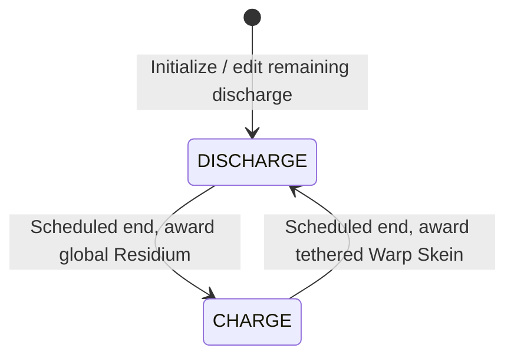

# Warp System — Calculator Specification

**Status:** Core Skein planning implemented; Residium calculator and automatic cycle synchronization incomplete.  
**Sources:** [Original spreadsheet — WarpCalculator](https://docs.google.com/spreadsheets/d/1xdB9Xdr1SLnLHsQxNrbUPB6cQrC62kfweJQfW6lQxJ8/edit), *Notes/Instructions* rows 46–57, [wiki: Warp Drive](https://spaceidle.game-vault.net/wiki/Warp_Drive), and current TypeScript implementation.

> **Scope warning:** The wiki describes the historical/general Warp Drive and massive Warp upgrades, whereas the calculator currently focuses on Titan-era **Senectus, Tiberinus and Ullr** Skein/Residium progression. Do not transplant early-Warp Essence mechanics directly into Titan-era Skein formulas.

## 1. Working calculator features

| Feature | Source | Current code | Status |
|---|---|---|---|
| Import current Skein, Warp progression and selected tether | Game save | `src/lib/saveImport/`, Supabase | Implemented |
| Load nodes, levels and dependencies | Supabase | `src/lib/warp/loadWarpData.ts` | Implemented |
| Next-level cost with full prerequisite chain | Spreadsheet | `src/lib/warp/warpPlanner.ts` | Implemented / tested |
| Multiple objectives with shared prerequisite deduplication | Calculator extension | `src/lib/warp/warpCombinedPlanner.ts` | Implemented / tested |
| Remaining levels and max-level costs | Spreadsheet | `src/lib/warp/warpMaxPlanner.ts` | Implemented / tested |
| Affordability based on discrete Skein cycles | Spreadsheet | `src/lib/warp/warpTiming.ts` | Implemented / tested with manual cycle inputs |
| Residium purchases, row completion totals | Spreadsheet | — | **Not implemented** |
| Automatic cycle countdown / award of Skein and Residium | Bound Google Apps Script | — | **Apps Script inspected; React equivalent not implemented** |
| Derive per-Warp cycle inputs from game state & modifiers | Save + bonus formulas | — | **Not implemented** |

## 2. Terminology and state

- **Tethered Warp:** the one currently accruing Skein; time estimates are shown only for that Warp in the original spreadsheet.
- **Current Skein:** resource balance for the selected Warp. Each Warp's balance is distinct.
- **Residium:** separate currency for its own upgrade table; accrues via discharge mechanics in the spreadsheet's automatic update.
- **Purchased level:** from imported game save.
- **Selected checkbox:** planning intention only, **not** a purchased level.
- **Locked (🔒):** prerequisite levels missing and the relevant dependency path not fully selected.
- **Planned unlock (🔓):** prerequisite levels missing, but all needed purchases are selected.
- **Maxed:** level at the node cap.
- **Current discharge remaining:** manual time input used to anchor the next expected Skein award.

In the original spreadsheet, the player enters the relevant charge time, discharge time, Skein per charge and Residium per discharge for each Warp. That is a **snapshot** of effective values (after modifiers), not the unmodified base values of the Warp upgrade definitions.

## 3. Skein objectives and dependencies

For a given *target's next level*:

1. Check whether the target is at max level.
2. Traverse its directed prerequisite graph recursively.
3. Skip a prerequisite if its imported level is already **greater than zero**.
4. Otherwise, include that prerequisite's first purchase only if it is explicitly selected.
5. Deduplicate prerequisites shared by multiple branches; sum each required purchase once.
6. Subtract **current Skein once** from the gross cost and clamp missing Skein to zero.

### Test vector: Ullr

- **Specimen Gain** level 0 costs **128** Skein.
- **Titan Battle** level 0 costs **256** Skein; requires Specimen Gain level 1.
- Selected together, total = **384** Skein. With **228** Skein, missing = **156** Skein.
- The game may display only the *individual item's* affordability (256 − 228 = 28), but our calculator must report the **full objective** including unpurchased prerequisites.

For multiple objectives, use `warpCombinedPlanner.ts`; do **not** sum individual “missing Skein” numbers, because that would subtract the same balance repeatedly and count shared prerequisites twice.

For **max-level** estimates, the spreadsheet's rightmost columns calculate `levelsRemaining × fixedLevelCost − currentSkein` only for **already-unlocked** nodes. Locked max-level rows remain locked rather than guessing their prerequisite budget. This differs deliberately from the next-level objective planner.

## 4. Cycle-based time estimates

For remaining Skein `S` after deducting current balance, Skein per charge `G`, charge duration `C`, full discharge duration `D`, and remaining discharge `R`:

```text
if S <= 0: time = 0
else:
  cycles = ceil(S / G)
  time = (R + C) + (cycles - 1) * (D + C)
```

This is the current spreadsheet-aligned estimate and implementation contract for `warpTiming.ts`. A correct timing estimate **cannot** be obtained by dividing missing Skein by a continuous per-second rate, because awards occur in complete cycles.

**Assumptions requiring game/script validation:** the next award occurs after the remaining discharge plus a charge, and charge/discharge order, paused/catch-up behaviour, and resource-award timestamps match the sheet's cycle logic. The bound Apps Script source is available as **project Library file `usi-apps-script.txt`** and has now been inspected. Its countdown state machine uses timestamp-anchored phase transitions with minute-based trigger updates. See the verified implementation notes below. The React counterpart is **not implemented**.

Example: `S=156`, `G=43.39`, `R=1070s`, `C=37s`, `D=1849s`: four award cycles, `6765s` = **01:52:45**.

**Changing upgrades matter:** some Warp, Research, Reactor and other bonuses change effective charge, discharge or Skein rates. The present estimate assumes the effective rates remain constant over the planned interval; it is **not** a dynamic purchase simulation.

## 4A. Wiki-verified Titan-era tether mechanics and baseline data

The [wiki's Tether Warp Locations section](https://spaceidle.game-vault.net/wiki/Warp_Drive) states that **Skein is awarded when a tethered Warp fully charges**, while **Residuum is awarded when its discharge completes**. The tethered location must first be cleared. Cleared Warp difficulties persist across reinforce. The wiki further states that each cleared difficulty above a location's starting difficulty multiplies Skein gain by **×1.35**, but does **not** increase Residuum gain.

| Warp | Wiki unlock condition | Starting difficulty | Base charge time | Base discharge time | Base Residuum per discharge |
|---|---|---:|---:|---:|---:|
| Senectus | Clear sector 150 | 151 | 1e11 seconds | 17,000 seconds | 20,000 |
| Tiberinus | Clear sector 156 | 157 | 1e12 seconds | 30,000 seconds | 40,000 |
| Ullr | Clear sector 163 | 164 | 3e12 seconds | 90,000 seconds | 140,000 |

These are **unmodified wiki baselines**, not current player rates. The spreadsheet's significantly shorter charge/discharge durations already reflect game progression and modifiers. Its displayed 'Sector Unlock' label may differ from the wiki's *clear condition* and *starting difficulty*; keep these concepts distinct.

The wiki states that **Warp Core Charge Speed** determines charge duration, while **Warp Discharge Speed** determines discharge duration. Exact speed-to-seconds calculations still need testing for Titan-phase effective stats.

## 4B. Apps Script countdown and payouts (source inspected)

**Primary source:** project Library file `usi-apps-script.txt` (46,892 bytes, inspected 2026-11-26). Relevant functions: `onEdit`, `handleCheckboxChange`, `toggleTrigger`, `resetWarpCycleToDischarge`, `initializeWarpPhase`, `updateWarpCountdown`, `applyWarpResourcePayout`, `getWarpLookupValue`, `parseDurationToMs` and `buyWarpLevelsDynamic`.

### Observed implementation

1. Enabling the sheet's Warp auto-update checkbox initializes the cycle and schedules `updateWarpCountdown` using a Google Apps Script **time-based trigger every one minute**. Disabling removes that trigger.
2. Editing the named `warpCurrDischarge` cell manually resets the phase to **DISCHARGE** using the edit timestamp, not the later completion time of script execution.
3. It stores `WARP_TARGET_TIME` (an absolute millisecond timestamp) and `WARP_PHASE` (`DISCHARGE` / `CHARGE`) in **Script Properties**. The UI countdown is a formatted *view* of the remaining time; it isn't the persistent source of truth.
4. On a tick, if the target timestamp lies in the future, it updates only the countdown.
5. If a phase has ended, it loops through **all overdue phase boundaries**, anchored on the *previous scheduled end timestamp* rather than resetting from the current time. This is how the script catches up when multiple cycles elapsed between triggers without drifting on each transition.
6. **At DISCHARGE completion**, `applyWarpResourcePayout(ss, "RESIDIUM")` increases the **global Residium** balance by the tethered Warp's displayed per-discharge gain, then enters **CHARGE**.
7. **At CHARGE completion**, `applyWarpResourcePayout(ss, "SKEIN")` increases only the **currently tethered Warp's Skein balance**, then enters **DISCHARGE**.
8. The sheet looks up charge/discharge duration and award rates via named ranges and the currently selected `TetheredWarp`. A single global Residium balance is distinct from per-Warp Skein balances.



### Implications for the React calculator

- Preserve explicit **phase + absolute target timestamp** if/when implementing a live countdown. A periodically refreshed UI timer should never serve as the authoritative progression state.
- Keep **global Residium**, **per-Warp Skein**, and **current tether** distinct.
- The existing `warpTiming.ts` estimate `(remaining discharge + charge) + (cycles-1) × full cycle` is aligned with this **DISCHARGE-first** starting state and the fact that Skein arrives at **charge completion**.
- The timer's catch-up and awards are **spreadsheet emulation**, not proof the real game grants those exact resources while offline. A future in-app automatic updater needs an explicit reconciliation policy with imported saves before writing anything to Supabase.

### Source-level hazards requiring correction *before reuse*

- The script contains **two declarations of `buyWarpLevelsDynamic`**; in JavaScript the later declaration overrides the earlier one. The later version selects cost/level columns conditionally. Audit the table-column mapping against real named ranges before porting purchase behavior.
- `getWarpLookupValue` returns `targetValues.getDisplayValues[index]`, although `targetValues` was obtained via `.getValues().flat()` and is an **array**. That expression does **not** index a value as intended and may throw. This could break phase-duration lookup during cycle transitions. The intended operation appears to be `targetValues[index]`, but this is a **proposed fix**, not a confirmed working correction.
- When `updateWarpCountdown` initializes from an absent target timestamp it calls `cyclePhase.setValue(phase)`, although **`phase` is undefined** in that scope. It should likely set `currentPhase`. Verify actual trigger behavior.
- `initializeWarpPhase` assigns `durationVal` without `var`, `let` or `const`, creating an implicit global in non-strict JavaScript; avoid this in TypeScript.
- The script's automatic award path uses `warpCurrResidium`, while the purchase path uses `ResidiumCurrent`. Verify these named ranges point at the same actual balance.
- When the tethered Warp changes, the active timer and lookup rates may need to be reset or reconciled; the `WarpDropdown` handling in `onEdit` is commented out.

These are **code-inspection findings**. Do not assume every issue manifests in the currently running spreadsheet without reproducing it.

## 5. Residium upgrades

The spreadsheet places the Residium upgrade table at the left of the WarpCalculator tab (starting around row 9).

**Wiki mechanic:** Residuum upgrade rows contain five levels per node, with subsequent level cost multiplying by **×1.25**. The basic published row starting costs are **10, 30, 90, and 270** Residuum, depending on row. These are candidate *base* costs; confirm the player's applicable progression and rounding before calculating actual purchases. Upgrades above the wiki's separator line persist on reinforce. See the wiki [Tether Warp Upgrades / Residuum](https://spaceidle.game-vault.net/wiki/Warp_Drive) section. Each upgrade has next-level cost/time and remaining-level cost/time.

Its **Row Completion** summaries aggregate a group of Residium upgrades, deducting the current balance only once. The summary requires its own aggregate formula and should **not** be implemented by adding each row's already-discounted “remaining” value.

**Next implementation task:** confirm how Residium upgrades/levels and actual Residium balance are represented in the imported save and in Supabase, then implement a pure Residium calculation engine with tests before adding it to WarpPanel.

## 6. Cross-system modifier inputs

See these observed stat snapshots:

- [Warp Core Charge Speed](../bonuses/Warp/warp-core-charge-speed.md): includes **flat additions**, **additive multipliers**, and **multiplicative multipliers**. These are distinct stages.
- [Warp Discharge Speed](../bonuses/Warp/warp-discharge-speed.md): displayed **48.66** in the user's snapshot, from many game systems.
- [Warp Skein Gain](../bonuses/Warp/warp-skein-gain.md): displayed **5.31**.
- [Warp Residuum Gain Multiplier](../bonuses/Warp/warp-residiuum-gain-multiplier.md): displayed **43.75**.
- [Residium upgrade persistence](../bonuses/Warp/residiuum-upgrade-persist.md): not necessarily a production-rate bonus; verify what survives resets.

**No aggregate snapshot multiplier is itself a formula for a Warp's actual charge duration.** Account for base timings, stage order, active bonuses and progression first.

## 7. Data model and tests

Current reference tables: `warps`, `warp_nodes`, `warp_node_dependencies`. Player tables: `player_warps`, `player_warp_nodes`, `player_warp_state`. Confirm live schemas before adding any fields.

Tests:
```bash
npx tsx src/lib/warp/warpPlanner.test.ts
npx tsx src/lib/warp/warpCombinedPlanner.test.ts
npx tsx src/lib/warp/warpTiming.test.ts
npx tsx src/lib/warp/warpMaxPlanner.test.ts
npm run build
```

### Implementation boundary

Finish accurate **calculator** functionality before introducing a strategy simulator. A genuine simulator must account for benefits of purchased upgrades to Titan, Synth, Research, Crew, Warp cycles and other systems, rather than treating purchases as isolated costs.

## 8. Reference links and open questions

- [Game wiki: Warp Drive](https://spaceidle.game-vault.net/wiki/Warp_Drive)
- [Spreadsheet: WarpCalculator and Notes/Instructions](https://docs.google.com/spreadsheets/d/1xdB9Xdr1SLnLHsQxNrbUPB6cQrC62kfweJQfW6lQxJ8/edit)
- Confirm the identified Apps Script lookup/phase issues against the live spreadsheet, and determine paused/resumed and tether-switch reconciliation behavior.
- What are the exact imported Residium balance and upgrade save keys?
- How do currently equipped modifiers produce per-Warp charge/discharge/Skein/Residium values?
- Which automatic timing rules differ across Titan-era Warps?

**Last reviewed:** 2026-11-26 (Apps Script inspected).
